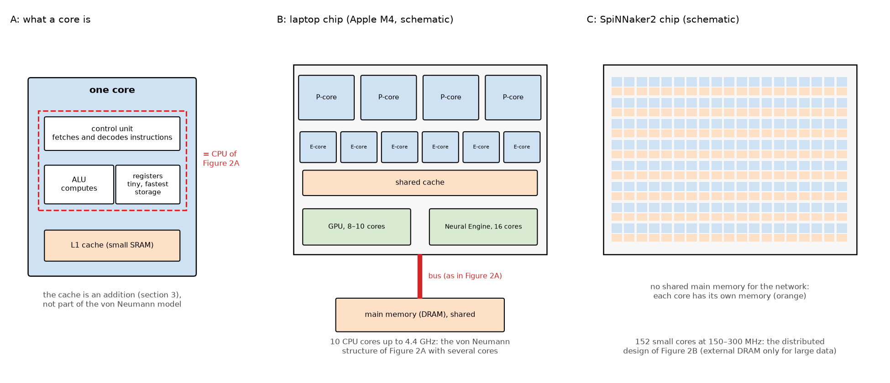
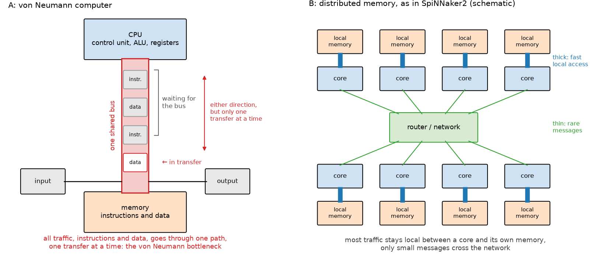
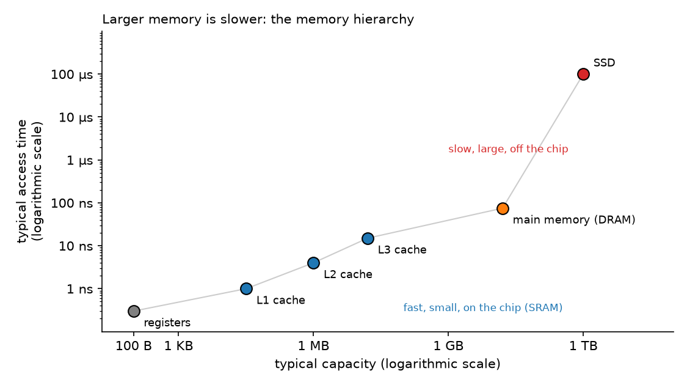
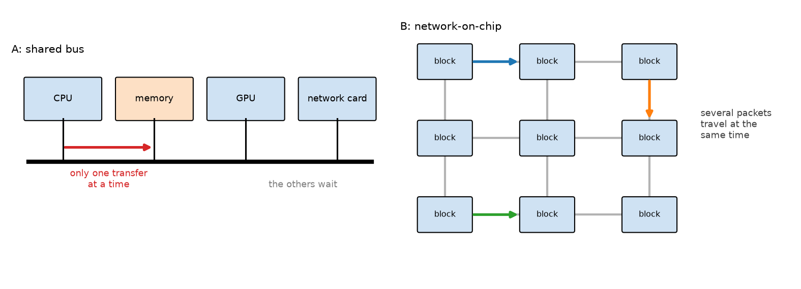
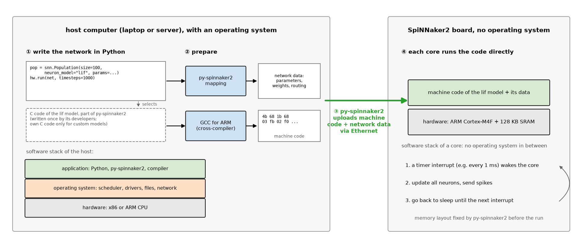

# Computing Fundamentals

General computing concepts that the other notes build on: bits and cores, the von Neumann architecture and its bottleneck, the memory hierarchy, buses, CPU architectures, and compilers and bare-metal programming. Background for readers without a computer engineering background. The neural computing basics are in `01_primer_snn_basics.md`, the SpiNNaker2 hardware in `02_hardware_energy.md`.

Sources: standard computer architecture knowledge, written up from a learning conversation. Where terms relate to SpiNNaker2, they follow the chip paper (Scholze et al. 2026) and the [py-spinnaker2 documentation](https://spinnaker2.gitlab.io/py-spinnaker2/).

Each section ends with a line **Workshop:** saying what of it is taught in the workshop.

## Contents

- [1. Computing basics](#1-computing-basics)
- [2. The von Neumann architecture](#2-the-von-neumann-architecture)
  - [The von Neumann bottleneck](#the-von-neumann-bottleneck)
- [3. Memory hierarchy](#3-memory-hierarchy)
  - [How caches fight the bottleneck](#how-caches-fight-the-bottleneck)
- [4. Buses and communication](#4-buses-and-communication)
- [5. CPU architectures: x86 and ARM](#5-cpu-architectures-x86-and-arm)
- [6. Compilers and bare-metal programming](#6-compilers-and-bare-metal-programming)

## 1. Computing basics

Everything a computer stores is ultimately binary. A **bit** is 0 or 1, and eight bits form a **byte** (256 possible values). Larger units are kilobyte (KB), megabyte (MB), gigabyte (GB) and terabyte (TB).

The **CPU** (central processing unit) executes instructions. A **core** is one independent processing engine: modern CPUs have several cores, each running its own stream of instructions. SpiNNaker2 takes this to an extreme with 152 cores per chip.

A **chip** (integrated circuit) is a piece of silicon with etched circuits. A **microcontroller** is a small, self-contained chip that combines a CPU, memory and input/output, designed for embedded devices. The ARM Cortex-M4F cores of SpiNNaker2 are microcontroller-class processors.

The **clock** is a timing signal, measured in hertz (Hz): a 3 GHz CPU performs three billion clock cycles per second. SpiNNaker2 cores run at a modest 150 or 300 MHz, trading the speed of a single core for parallelism and energy efficiency.

**Example:** a MacBook Air with Apple M4 (2025) has a CPU with 10 cores: 4 performance cores (up to about 4.4 GHz) and 6 slower, more power-efficient efficiency cores. Next to it on the same chip sit a GPU with 8 or 10 cores and a Neural Engine with 16 cores for ML inference. A SpiNNaker2 chip has about 15 times as many cores (152), each running 15 to 30 times slower (150–300 MHz): many slow cores instead of a few fast ones.

***Figure 1.** How cores relate to the von Neumann model of Figure 2A. A: a core is one independent processing engine. Its control unit, ALU and registers (dashed frame) are exactly what the von Neumann model calls the CPU. The L1 cache is a later addition that works around the von Neumann bottleneck (section 3). B: a laptop chip places several such cores on one chip. They share a cache and, over a bus, one main memory outside the chip: the von Neumann structure of Figure 2A, with several CPUs instead of one. The GPU and the Neural Engine are further processors with their own cores. C: a SpiNNaker2 chip instead has 152 small, slow cores, each with its own local memory, so the network doesn't run through a shared bus to a main memory: the distributed design of Figure 2B. **Source:** Diagram. Core counts from the manufacturers' specifications, sizes and positions schematic, not to scale.*

**Workshop:** not taught, assumed background.

## 2. The von Neumann architecture

The **von Neumann architecture**, described by John von Neumann in 1945, is the blueprint of almost every general-purpose computer. Its central idea is the **stored-program concept**: instructions and data live together in the same memory, in the same binary format. A CPU repeats the **fetch–decode–execute cycle**: fetch an instruction from memory, decode it, execute it, move on to the next one. The classical components are memory, a control unit, an arithmetic logic unit (ALU), input and output. Control unit and ALU together form the CPU.

### The von Neumann bottleneck

Instructions and data share one memory and one connection to the CPU, so only one transfer can happen at a time. CPUs became much faster than memory over the decades, and this shared path became the performance limit: the **von Neumann bottleneck**, a term coined by John Backus in his 1977 Turing Award lecture. Caches, prefetching, wider buses and out-of-order execution are all workarounds for it.

The main alternative is the **Harvard architecture**, with separate memories and paths for instructions and data. Most modern CPUs use a "modified Harvard" design internally (separate caches for instructions and data) while presenting a single von Neumann memory to software.

Neuromorphic chips like SpiNNaker2 attack the bottleneck differently: each core has its own local memory next to it and keeps the data for its neurons there. The chip also has a DRAM that all cores share, but the SNN software doesn't use it for the work of each timestep, so the cores don't compete for one shared memory (`02_hardware_energy.md`, section 3).

***Figure 2.** A: in a von Neumann computer, the CPU, the memory, input and output all share one bus. Instructions and data travel over it one transfer at a time, and further requests have to wait, so the speed of this single path limits the whole computer. B: in a distributed design like SpiNNaker2, every core has its own local memory right next to it (thick blue links), so most memory accesses stay local and don't compete with each other. Cores only exchange small messages through a router (thin green lines). **Source:** Diagram.*

**Workshop:** 2 min in the motivation block, as the problem that neuromorphic hardware addresses.

## 3. Memory hierarchy

Computers combine several kinds of memory, trading speed against capacity and cost:

| Level | Technology | Typical size | Access time | Role |
|---|---|---|---|---|
| Registers | inside the core | bytes | < 1 ns | fastest working storage |
| L1 cache | SRAM, per core | ~32 KB | ~1 ns | most recently used data |
| L2 cache | SRAM, near the core | ~1–2 MB | ~3–5 ns | second-level cache |
| L3 cache | SRAM, shared | ~8–32 MB | ~10–20 ns | shared by all cores |
| Main memory | DRAM | ~16 GB | ~50–100 ns | working memory of programs |
| SSD / HDD | flash / magnetic | TB | µs–ms | persistent storage |

- **RAM** (random access memory): volatile working memory in which any location can be accessed directly.
- **DRAM** (dynamic RAM): dense and cheap, but slower, and it needs constant refreshing. Used as main memory. LPDDR4 is a low-power variant.
- **SRAM** (static RAM): faster and more expensive, no refresh needed. Used for caches, and for the local memory of each SpiNNaker2 processing element.
- **VRAM:** the dedicated memory of GPUs, typically GDDR or HBM.
- **Cache:** a small, fast SRAM buffer between the CPU and main memory that holds recently or frequently used data.

### How caches fight the bottleneck

A cache doesn't make main memory any faster. It keeps copies of recently used data close to the core, so that most requests never have to go to DRAM. Caches therefore *hide* the von Neumann bottleneck rather than remove it, and they only work as long as the core's next requests are predictable.

**Locality.** Most programs make predictable requests in two ways:

- **Temporal locality:** data that was just used is likely to be used again soon. Example: a loop counter, or the weights of a layer that are applied to many inputs in a row.
- **Spatial locality:** data next to what was just used is likely to be needed next. Example: going through an array element by element. The cache therefore always loads a small block of neighbouring data at once (typically 64 bytes, a *cache line*), not just the single value that was asked for.

On top of that, a **prefetcher** watches the pattern of requests. If the program reads element 1, 2, 3 of an array, it fetches 4, 5, 6 before they are requested.

<b>Worked example:</b> why a 95 % hit rate is almost as good as 100 %

 

With an access time of 1 ns for the cache and 75 ns for DRAM (Figure 3): if 95 % of the requests find their data in the cache (a *hit*) and 5 % have to go to DRAM (a *miss*), the average access takes

$$0.95 \times 1\ \text{ns} + 0.05 \times 75\ \text{ns} \approx 4.7\ \text{ns} \tag{1}$$

That is 16 times faster than going to DRAM every time. But it also shows how sensitive this is: at an 80 % hit rate, the average rises to about 16 ns, and at 50 % to about 38 ns. A few misses already dominate the average.

 

**When the trick fails.** Caches only help if the program's next request is predictable. Some workloads jump around in memory: a search through a large, sparse graph, or a large neural network in which each neuron is connected to a few, scattered other neurons. When a spike arrives, the weights needed for it can lie anywhere in memory. Neither locality nor the prefetcher helps, most requests miss the cache, and the CPU spends most of its time waiting for DRAM. This is one reason why SpiNNaker2 takes a different approach: instead of predicting which data to keep in a cache, each core has all the data for its own neurons permanently in its local memory (Figure 2B).

***Figure 3.** The levels of the table above, with capacity against access time. Each step down the hierarchy gives about 10 to 1000 times more capacity, at the price of slower access. Note the jump between the caches on the chip and DRAM off the chip. **Source:** Typical orders of magnitude from the table above, not measurements of a specific computer.*

**Workshop:** not taught separately. The energy cost of memory access is in the primer (Figure 25).

## 4. Buses and communication

A **bus** is a shared communication path, a bundle of wires plus a protocol, that carries data between components. It typically has address lines (where), data lines (what) and control lines (read, write, ready). Only one sender can use a bus at a time.

The **memory bus** connects the CPU with main memory. It is the physical form of the von Neumann bottleneck. Two properties matter: **bandwidth** (bytes per second) and **latency** (time per transfer). Buses are relieved by making them wider or faster, by giving CPUs several memory channels, and by caches, which reduce how often the bus is needed.

Other buses in a computer are **PCIe** (CPU to GPUs, SSDs, network cards) and USB (external devices). Inside large chips, a **network-on-chip** (NoC) replaces the shared on-chip bus. Instead of one set of wires that all blocks take turns on, the blocks (cores, memory interfaces, router) are connected by many short links with small routers in between, so many transfers can happen at the same time (Figure 4B). SpiNNaker2 uses one (`02_hardware_energy.md`, section 4).

<b>Network-on-chip vs. PCIe:</b> two networks at different scales

 

A NoC is not an improvement over PCIe, it solves the same problem at a different scale. Both send data as packets over point-to-point links, and both consist of physical wires, but of very different kinds:

| | Network-on-chip | PCIe |
|---|---|---|
| Connects | blocks on the same piece of silicon (cores, memory interfaces, router) | separate chips (CPU, GPU, SSD, network card) |
| Wires | metal wires in the chip's own wiring layers | copper traces on the circuit board, connectors |
| Distance | millimetres | centimetres |
| Improves on | a shared bus inside the chip | the older shared PCI bus between chips |

The main advantage of staying on the chip is cost: short on-chip wires need much less energy and time per bit than a trip to another chip, which has to drive long board traces and pass through the chip's input/output circuits. This is the same reason why on-chip SRAM is cheaper to access than off-chip DRAM (primer, Figure 25), and why SpiNNaker2 keeps as much communication as possible on the chip: spikes between cores on the same chip only travel through the NoC, and only spikes to other chips use the slower chip-to-chip links.

 

<b>PCIe:</b> how GPUs, SSDs and network cards are connected

 

[PCI Express](https://en.wikipedia.org/wiki/PCI_Express) (PCIe) connects the CPU with expansion devices such as GPUs, SSDs and network cards. Despite the name, it isn't a shared bus any more: every device has its own **point-to-point link** to the CPU (or to a switch), so devices don't compete for the same wires.

- **Lanes.** A link consists of 1, 4, 8 or 16 *lanes* (written x1, x4, x8, x16). Each lane has one wire pair per direction, so data can flow both ways at the same time. A GPU typically uses x16, an SSD x4.
- **Serial transmission.** Each lane sends bits one after another at very high speed instead of many bits in parallel, because many parallel wires are hard to keep synchronised over longer distances. The receiver recovers the clock from the data stream itself (SerDes, serialiser/deserialiser). SpiNNaker2 does the same on its links between boards, while on a board, over a few centimetres, its chip-to-chip links still send 6 bits in parallel with a separate clock (`02_hardware_energy.md`, section 4).
- **Packets.** Data travels in packets with an address and a checksum, much like in a small network.
- **Generations.** Each generation roughly doubles the speed per lane: about 1 GB/s per lane and direction for PCIe 3.0, 2 GB/s for 4.0, 4 GB/s for 5.0 and 8 GB/s for 6.0. A PCIe 4.0 x16 link to a GPU therefore carries about 32 GB/s in each direction.

**Why this matters for ML:** a GPU's own memory (HBM) delivers several TB/s, about 50 to 100 times more than the PCIe link through which data reaches the GPU. Moving data between CPU and GPU is therefore slow compared with computing on it, which is why training frameworks keep models and batches in GPU memory as much as possible. SpiNNaker2 boards are not connected via PCIe but via Ethernet (1 Gbit/s), which is enough because only the network description, the input spikes and the results have to be transferred.

 

<b>Ethernet:</b> how separate computers are connected, compared with PCIe

 

[Ethernet](https://en.wikipedia.org/wiki/Ethernet) is the standard technology for connecting separate computers into a network. Data travels in *frames* that carry the address of the sender and the receiver (MAC addresses) and are forwarded by switches. Protocols such as IP, TCP and [UDP](https://en.wikipedia.org/wiki/User_Datagram_Protocol) run on top of it. Cables are copper (up to about 100 m) or optical fibre (kilometres). Typical speeds are 1 Gbit/s in offices and 10–400 Gbit/s in data centres.

| | PCIe | Ethernet |
|---|---|---|
| Connects | chips inside one computer (CPU, GPU, SSD) | separate computers and devices |
| Distance | centimetres, on the circuit board | metres to kilometres |
| Speed | about 32 GB/s (PCIe 4.0 x16) | 1 Gbit/s ≈ 0.125 GB/s (office), up to 400 Gbit/s (data centre) |
| Latency | below 1 µs | several µs to milliseconds, depending on the network |
| Addressing | directly in the CPU's address space: the CPU reads and writes device memory almost like its own | network messages with IP addresses, handled by the network stack of the operating system |

PCIe is much faster and more direct, but only works within one computer. Ethernet is slower, but works across distances and between many devices.

**SpiNNaker2 boards** are connected to the host computer via 1 Gbit Ethernet, using UDP. A board is therefore a separate network device with its own IP address, which can be checked with ping or a UDP probe. The bandwidth is low compared with PCIe, but sufficient, because only the network description, the input spikes and the results travel between host and chip, while the computation happens on the chip. It becomes a limit when large amounts of data are streamed live between host and chip.

 

***Figure 4.** A: on a shared bus, all components are connected to the same wires, so only one transfer can take place at a time and the others have to wait. B: in a network-on-chip, blocks are connected by many short links, and several packets can travel between different blocks at the same time. **Source:** Diagram.*

**Workshop:** not taught.

## 5. CPU architectures: x86 and ARM

An **instruction set architecture** (ISA) is the vocabulary of instructions a CPU understands. Two families dominate:

- **x86** (Intel, AMD, since 1978): a CISC design (complex instruction set computer), developed for desktops and servers. Powerful and backwards-compatible to the 1970s, but with higher power consumption.
- **ARM** (Acorn Computers, 1985; since 1990 Arm Holdings): a RISC design (reduced instruction set computer), originally developed for Acorn's [Archimedes](https://en.wikipedia.org/wiki/Acorn_Archimedes) desktop computer. Its small, simple and power-efficient cores later made it the standard for mobile and embedded devices. Arm licenses its designs to many companies, which build their own chips.

**RISC vs. CISC:** CISC offers powerful instructions that may do several things at once, which needs complex hardware. RISC uses simple, uniform instructions, arithmetic only between registers, and separate load and store instructions, which keeps the hardware simple. Modern x86 chips internally translate their instructions into RISC-like micro-operations, so the difference has blurred. A measurement study of ARM and x86 cores found that the instruction set itself makes little difference to energy efficiency; what matters is the design point, e.g. small, simple cores at a low clock rate versus large, fast ones ([Blem et al. 2013](https://research.cs.wisc.edu/vertical/papers/2013/hpca13-isa-power-struggles.pdf), HPCA).

**Why ARM for SpiNNaker2:** in a system with millions of cores, the power and silicon area per core dominate the design. There is also a personal link: [Steve Furber](https://en.wikipedia.org/wiki/Steve_Furber) co-designed the first ARM processor at Acorn and later led the SpiNNaker project at the University of Manchester. The Cortex-M4F is small and efficient, so 152 of them fit on one chip at low power. The workload consists of many small parallel updates, so the high single-core performance of x86 isn't needed, and mature ARM compilers and debuggers are available. Apple's M-series chips chose ARM for similar reasons: energy efficiency and the freedom to design their own chips. **RISC-V**, a newer, royalty-free RISC instruction set, may appear in future neuromorphic chips for the same reasons.

**Workshop:** 1 min at most, as background to "why small ARM cores".

## 6. Compilers and bare-metal programming

A **compiler** translates source code (C, C++, Rust, …) into machine code for a specific CPU. The main phases are lexical analysis, parsing, semantic analysis, optimisation and code generation. Machine code is specific to an instruction set: a program compiled for x86 doesn't run on ARM without recompiling it, translating its machine code (as Apple's Rosetta 2 does) or emulating the other architecture.

**Cross-compilation** means compiling on one architecture for another. It is essential for embedded systems: code is compiled on a laptop or server and runs on ARM Cortex-M4F cores. The chip software of SpiNNaker2 is written in C and compiled with a GCC toolchain for ARM (chip paper). Users of py-spinnaker2 don't write or compile this code themselves: they describe the network in Python, and py-spinnaker2 compiles the C code of the selected neuron models automatically with CMake and `arm-none-eabi-gcc`, from the public snn-core repository, and caches the results (`make_clean=True` in `hw.run` forces a rebuild). C only has to be written for custom neuron models.

**CMake** is a meta build tool: one `CMakeLists.txt` describes the project, and CMake generates the platform-specific build files (Makefiles, Ninja files, Visual Studio projects). It is widely used for C and C++ projects.

**Bare-metal** programming means running code directly on the hardware, without an operating system in between: no file system, no scheduler, no drivers, but full control over the hardware and predictable timing. Each SpiNNaker2 core runs its neuron model as bare-metal C code. There is no Linux on the cores and no automatic memory management, which is why the memory of each core is laid out explicitly by py-spinnaker2 (`02_hardware_energy.md`, section 3).

***Figure 5.** How a network gets onto the SpiNNaker2 cores. ① The user describes the network in Python with py-spinnaker2 and only selects the neuron model by name (here `lif`). The C code of the neuron models is part of py-spinnaker2, written once by its developers. Own C code is only needed for custom neuron models. ② On the host, py-spinnaker2 turns the Python description into network data (parameters, weights, routing tables), and a cross-compiler translates the C code of the model into machine code for the ARM cores. ③ py-spinnaker2 sends both to the board via Ethernet. ④ On the chip, each core runs the machine code directly on its hardware, without an operating system in between: a timer interrupt wakes it once per timestep, it updates its neurons and sends spikes, and then sleeps until the next interrupt. The software stacks show the difference: three layers on the host, two on a core. **Source:** Diagram. The code snippets are simplified and the machine code bytes are illustrative.*

**Workshop:** not taught. Relevant for custom neuron models in C, which are an advanced topic.
