# Primer: Spiking Neurons and Networks

The groundwork for the "Basics" block of the workshop (30 min) and a reference for the workshop material. Written for readers with a physics or ML background and no prior knowledge of neuroscience. All chip-specific details refer to py-spinnaker2 v0.8 ([neuron models](https://spinnaker2.gitlab.io/py-spinnaker2/api_reference/neuron-models.html), [SNN intro](https://spinnaker2.gitlab.io/py-spinnaker2/user_guide/snn-intro.html)).

Each section ends with a line **Workshop:** saying what of it is taught in the workshop.

## Contents

- [1. Why spikes?](#1-why-spikes)
- [2. From Hodgkin-Huxley to LIF](#2-from-hodgkin-huxley-to-lif)
  - [2.1 Hodgkin-Huxley (4 variables)](#21-hodgkin-huxley-4-variables)
  - [2.2 FitzHugh-Nagumo (2 variables)](#22-fitzhugh-nagumo-2-variables)
  - [2.3 From FitzHugh-Nagumo to LIF (1 variable)](#23-from-fitzhugh-nagumo-to-lif-1-variable)
  - [2.4 The LIF equation, term by term](#24-the-lif-equation-term-by-term)
  - [2.5 Threshold, reset and the firing rate](#25-threshold-reset-and-the-firing-rate)
- [3. LIF in discrete time, as on the chip](#3-lif-in-discrete-time-as-on-the-chip)
- [4. Synapses](#4-synapses)
- [5. Other neuron models on the chip](#5-other-neuron-models-on-the-chip)
- [6. Getting data in and out](#6-getting-data-in-and-out)
- [7. Networks](#7-networks)
- [8. SNNs and deep learning](#8-snns-and-deep-learning)
- [9. Why this can save energy](#9-why-this-can-save-energy)
- [Glossary](#glossary)
- [To check on the cluster](#to-check-on-the-cluster)

## 1. Why spikes?

A biological neuron collects input from thousands of others through its [synapses](https://en.wikipedia.org/wiki/Synapse). The input charges its membrane. Once the membrane potential crosses a threshold, the neuron fires a short electrical pulse, a *spike* ([action potential](https://en.wikipedia.org/wiki/Action_potential)), and then resets. The spike has a fixed shape, so all information sits in *whether* and *when* a neuron fires, not in the pulse itself.

Two consequences matter for computing:

- **Communication is binary and event-based.** A neuron sends one bit ("I fired") at a point in time instead of a floating-point activation every step.
- **Activity is sparse.** Most neurons are silent most of the time. If hardware only computes when a spike arrives, it does very little work for a silent network. This is the root of the energy argument (section 9).

**Workshop:** 2 min, one picture of a spike train.

## 2. From Hodgkin-Huxley to LIF

Neuron models form a ladder: the more variables, the more biological detail, and the more computation per neuron. Computing only needs what carries information, which is *when* spikes happen, so the useful direction is down the ladder.

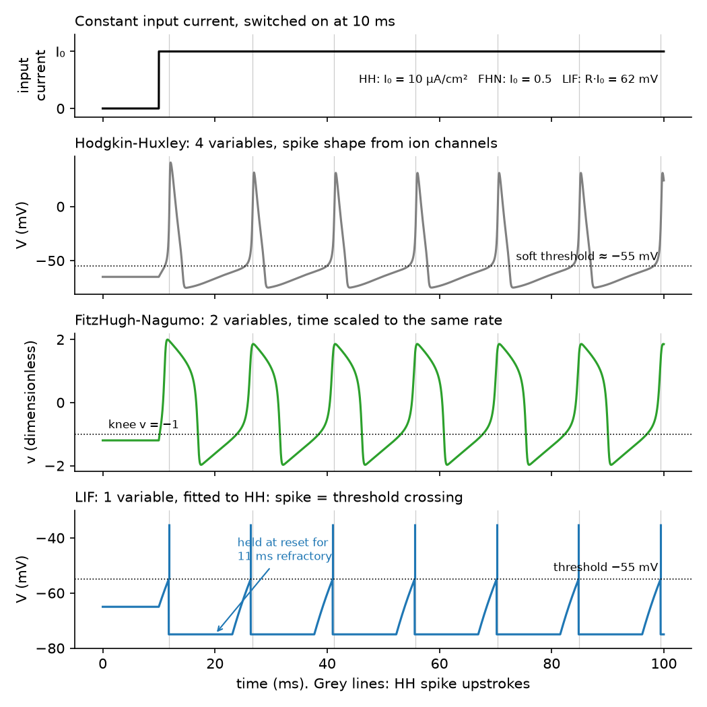

***Figure 1.** Top: a constant input current, switched on at 10 ms. Each model has its own units, so the values of $I_0$ differ. Hodgkin-Huxley is the reference. FitzHugh-Nagumo's time axis is stretched and LIF's parameters are fitted so that all three fire at the same times (grey lines: HH upstrokes). Only the spike shape and the cost differ. **Source:** Simulated here in `make_figures.py`: Hodgkin-Huxley with the classic squid-axon parameters, FitzHugh-Nagumo with the standard parameters ($a$ = 0.7, $b$ = 0.8, $\tau_w$ = 12.5), LIF fitted to the HH spike times.*

<details>
<summary><b>Reading Figure 1:</b> soft vs. hard threshold, and why the fitted LIF needs a long refractory period</summary>

- **HH and FitzHugh-Nagumo have no fixed threshold.** A spike is a process: once $V$ gets to around −55 mV, the sodium channels open faster than the leak can pull $V$ back, and $V$ runs away upward. The peak follows about 1 ms later. This *soft threshold* emerges from the dynamics and even shifts with how fast the input rises. In FitzHugh-Nagumo, it's the knee of the phase plane (Figure 2).
- **In LIF, the threshold crossing is the spike.** It happens instantly, and the drawn vertical line is only a marker. That's why LIF's spikes sit at the *start* of the HH upstrokes, not at the peaks.
- **HH responds quickly but recovers slowly.** The first spike comes about 2 ms after the input switches on, and after each spike the potassium channels take over 10 ms to close again. A plain LIF can't reproduce both, so the fitted LIF resets below rest (−75 mV, like HH's [afterhyperpolarization](https://en.wikipedia.org/wiki/Afterhyperpolarization)) and holds there for an 11 ms [refractory period](https://en.wikipedia.org/wiki/Refractory_period_(physiology)). This is the typical LIF trade: the slow recovery dynamics become a fixed waiting time.

</details>

<br>

### 2.1 Hodgkin-Huxley (4 variables)

[Hodgkin-Huxley](https://en.wikipedia.org/wiki/Hodgkin%E2%80%93Huxley_model) describes the [membrane potential](https://en.wikipedia.org/wiki/Membrane_potential) $V$ plus three gating variables $m, h, n$ for the sodium and potassium channels. It reproduces the spike shape accurately, but needs four coupled non-linear ODEs and a small integration step. The spike shape is always the same, so modelling it in detail costs compute without adding information.

### 2.2 FitzHugh-Nagumo (2 variables)

The [FitzHugh-Nagumo model](https://en.wikipedia.org/wiki/FitzHugh%E2%80%93Nagumo_model) reduces HH to two variables that keep its qualitative behaviour:

$$\frac{dv}{dt} = v - \frac{v^3}{3} - w + I, \qquad \tau_w \frac{dw}{dt} = v + a - b\,w \tag{1}$$

- $v$ is fast and plays the role of the membrane potential (HH's $V$ together with the fast sodium activation $m$).
- $w$ is slow, a "recovery" variable (HH's slow gates $h$ and $n$). It builds up during a spike and pulls $v$ back down.
- The cubic term $-v^3/3$ makes the neuron *excitable*. A small push decays back to rest, but a push past a critical point triggers a large excursion, the spike.

The dynamics are easiest to see in the [phase plane](https://en.wikipedia.org/wiki/Phase_plane), with $v$ against $w$:

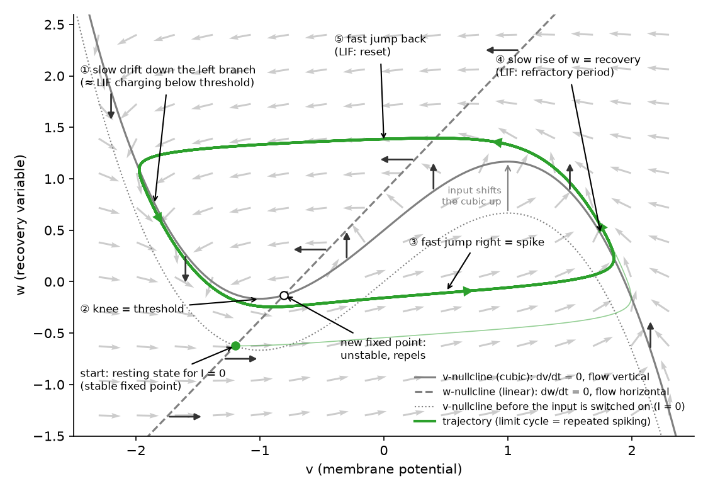

***Figure 2.** The [nullclines](https://en.wikipedia.org/wiki/Nullcline): where $dv/dt = 0$ (cubic curve) and $dw/dt = 0$ (straight line), the state doesn't change in that direction. Because $v$ is much faster than $w$, the trajectory creeps along the outer branches of the cubic curve and jumps quickly between them. Grey arrows: direction of the flow. Black arrows: flow on the nullclines. Green arrowheads: direction of travel. With constant input $I$ = 0.5 this gives a closed loop (a [limit cycle](https://en.wikipedia.org/wiki/Limit_cycle)), repeated spiking. **Source:** Simulated here in `make_figures.py` (FitzHugh-Nagumo, same parameters as Figure 1).*

The loop has five steps. ① The state drifts slowly along the left branch. ② At the knee, the left branch ends, so there is no stable state left, and ③ $v$ jumps quickly to the right branch: a spike. ④ On the right branch, $w$ rises slowly (recovery) until ⑤ that branch ends too and $v$ falls back to the left. Then the loop repeats.

<details>
<summary><b>What starts the loop:</b> how the input destabilises the resting state</summary>

Before the input is switched on ($I = 0$, dotted cubic), the two nullclines intersect at a stable fixed point, the resting state. The input $I$ appears only in $dv/dt$, so switching it on shifts the whole cubic up by $I$ while the straight line stays put. The old resting point now lies below the new cubic, where $dv/dt = I > 0$, and is pushed to the right. The nullclines now intersect just past the knee, on the middle branch. That fixed point is unstable (open circle): it repels the state instead of attracting it. With no stable state left, the trajectory settles onto the limit cycle. For weak input, the intersection stays on the left branch, remains stable, and the neuron doesn't spike. This is the counterpart of LIF's critical input. For these parameters the switch happens at $I \approx 0.33$, a [Hopf bifurcation](https://en.wikipedia.org/wiki/Hopf_bifurcation).

</details>

<br>

<details>
<summary><b>Why the loop runs counterclockwise:</b> reading the flow from the nullclines</summary>

The sign of each derivative flips at its nullcline, and the arrows in Figure 2 show which way:

- **Horizontal direction**, from $dv/dt = v - v^3/3 - w + I$: below the cubic curve $dv/dt > 0$, so the flow goes right. Above it the flow goes left. *On* the cubic curve, $dv/dt = 0$, so the flow there is purely vertical (black arrows on the solid line).
- **Vertical direction**, from $\tau_w\,dw/dt = v + a - b\,w$: below and to the right of the straight line $dw/dt > 0$, so the flow goes up. Above and to the left, it goes down. *On* the line, the flow is purely horizontal (black arrows on the dashed line).
- **Speed:** $v$ is much faster than $w$ ($\tau_w$ = 12.5), so almost everywhere the flow is nearly horizontal (grey arrows). The state rushes sideways until it hits the cubic curve, where $dv/dt$ vanishes, and only there does the slow vertical motion take over.

Combined: on the right, the flow goes up. At the top, it goes left. On the left, it goes down, and at the bottom it goes right. That is a counterclockwise rotation (green arrowheads).

</details>

<br>

### 2.3 From FitzHugh-Nagumo to LIF (1 variable)

LIF is not a mathematical limit of FitzHugh-Nagumo but a caricature of the same structure. Every step of the loop maps to a simpler rule:

| FitzHugh-Nagumo | LIF |
|---|---|
| Near rest, on the left branch, the dynamics are approximately linear: $v$ is pulled back to rest in proportion to its distance from it | Keep only this linear part: a leaky integrator (the ODE below) |
| The knee, past which a spike becomes unavoidable | A fixed threshold $V_\text{th}$ |
| The fast excursion, the spike itself | An event: "neuron fired at time $t$". The shape is dropped. |
| The slow return via $w$ | Reset $V$ to a fixed value, optionally hold it there for a refractory period |

So LIF needs one variable instead of two or four, and the part it dropped is the part that carries no information. (Historically, the order is reversed: [Lapicque](https://en.wikipedia.org/wiki/Louis_Lapicque) proposed integrate-and-fire in 1907, before Hodgkin-Huxley in 1952 and FitzHugh-Nagumo in 1961/62.)

### 2.4 The LIF equation, term by term

Physically, LIF (see [biological neuron models](https://en.wikipedia.org/wiki/Biological_neuron_model)) is an [RC circuit](https://en.wikipedia.org/wiki/RC_circuit): the membrane is a capacitor $C$, the ion channels at rest form a leak resistor $R$, and the input is a current $I(t)$. The LIF equation follows from current conservation in this circuit:

<details>
<summary><b>Derivation:</b> from the RC circuit to the LIF equation</summary>

<br>

**The circuit.** The membrane separates the inside of the cell from the outside and is modelled by two parallel branches, a capacitor on one and a resistor in series with a battery on the other:

- a **capacitor** $C$: the conducting fluids inside and outside act as two plates, and the lipid bilayer, only about 5 nm thick, is the insulator between them. Charging the membrane means ions piling up on both sides of it.
- a **leak resistor** $R$: ion channels that are always open let some current through
- a **battery** $V_\text{rest}$ in series with the resistor: concentration differences of the ions across the membrane drive a current even without input. The battery voltage is the [resting potential](https://en.wikipedia.org/wiki/Resting_potential) (more precisely, the [reversal potential](https://en.wikipedia.org/wiki/Reversal_potential) of the leak channels), typically around −65 mV.

An input current $I(t)$, from synapses or an electrode, is injected into the cell.

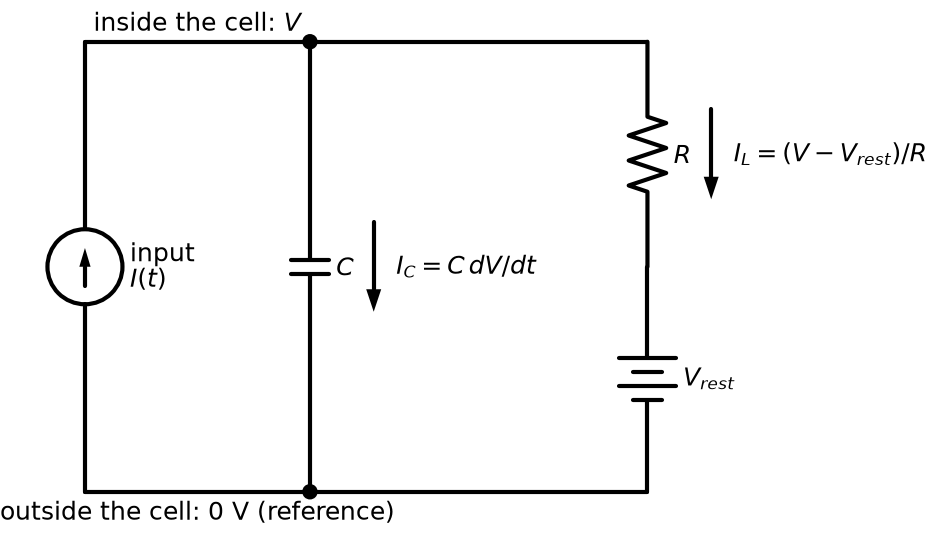

***Figure 3.** The membrane as an electrical circuit. The top wire is the inside of the cell, the bottom wire the outside. Only potential differences matter, so the outside serves as the reference at 0 V (like ground in a circuit), and $V$ is the voltage across the membrane, inside minus outside. The input current splits into a capacitive current $I_C$ that charges the membrane and a leak current $I_L$ through the ion channels. **Source:** Diagram.*

**Step 1: currents through each element.**

- Capacitor: the stored charge $Q$ (in coulombs) is proportional to the voltage, $Q = C V$, with the capacitance $C$ (in farads, F = C/V) saying how much charge is stored per volt. A current is charge per time, so the current that charges it is $I_C = \dfrac{dQ}{dt} = C\,\dfrac{dV}{dt}$.
- Leak branch (resistor and battery): Ohm's law applies to the voltage across the resistor alone, which is the membrane voltage minus the battery voltage. So $I_L = \dfrac{V - V_\text{rest}}{R}$. At $V = V_\text{rest}$ no leak current flows, and that's what makes it the resting state.

**Step 2: current conservation.** By [Kirchhoff's current law](https://en.wikipedia.org/wiki/Kirchhoff%27s_circuit_laws), the injected current has to go somewhere. It splits between the two parallel branches:

$$I = I_C + I_L = C\,\frac{dV}{dt} + \frac{V - V_\text{rest}}{R} \tag{2}$$

**Step 3: solve for the rate of change.**

$$C\,\frac{dV}{dt} = -\frac{V - V_\text{rest}}{R} + I \tag{3}$$

The input current charges the capacitor, and the leak current discharges it.

**Step 4: multiply by $R$.**

$$RC\,\frac{dV}{dt} = -(V - V_\text{rest}) + R\,I \tag{4}$$

Now every term has units of voltage. The product $\tau_m = RC$ has units of time (Ω · F = s) and is the membrane time constant. The input appears as $R\,I$: the voltage a constant current $I$ would produce across the resistor alone. That's also where $V$ settles for constant input: $V$ keeps changing until the leak current exactly cancels the input, so that no current is left to charge the capacitor and $dV/dt = 0$. Setting $dV/dt = 0$ in Eq. (4) gives $V_\infty = V_\text{rest} + R I$. All input current then flows through the resistor and causes the voltage drop $R I$ across it.

**Typical values**, per unit membrane area: $C_m \approx$ 1 µF/cm² and $R_m \approx$ 10–20 kΩ·cm², so $\tau_m \approx$ 10–20 ms. The area cancels in $\tau_m$, so the time constant is a property of the membrane material and not of the cell's size.

</details>

<br>

With $\tau_m = RC$:

$$\underbrace{\tau_m \frac{dV}{dt}}_{\text{rate of change}} = \underbrace{-(V - V_\text{rest})}_{\text{leak: pulls back to rest}} + \underbrace{R\,I(t)}_{\text{input: pushes up}}, \qquad \tau_m = RC \tag{5}$$

- **Leak:** the further $V$ is from rest, the harder it's pulled back (Ohm's law for the leak current).
- **Input:** pushes $V$ up (excitatory) or down (inhibitory).
- **[Time constant](https://en.wikipedia.org/wiki/Time_constant) $\tau_m$:** how fast $V$ reacts, typically 10–20 ms in biology. It sets how long the neuron "remembers" past input.

For constant input, the two terms balance at the steady state $V_\infty = V_\text{rest} + RI$, and $V$ approaches it exponentially:

$$V(t) = V_\infty + (V_0 - V_\infty)\,e^{-t/\tau_m} \tag{6}$$

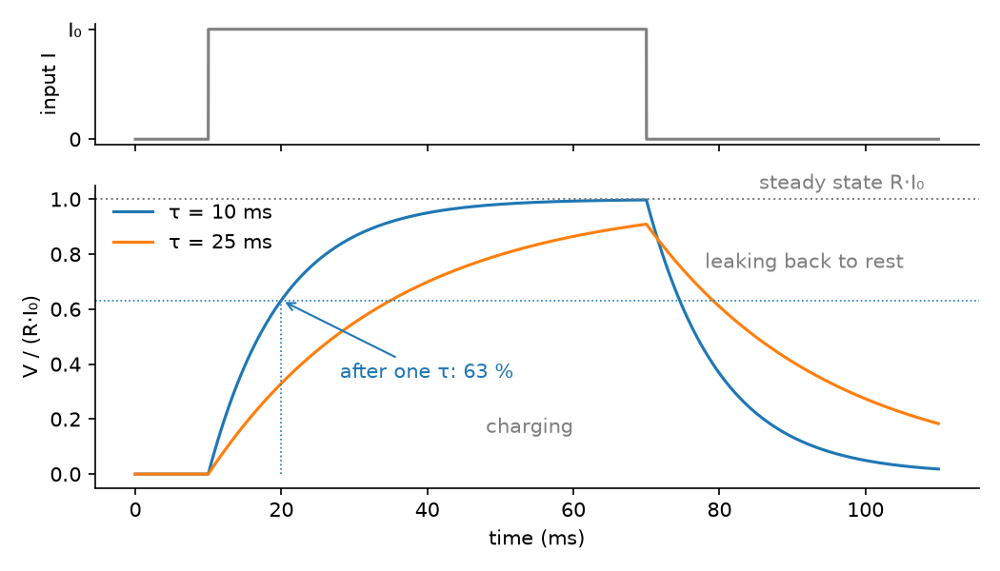

***Figure 4.** Below threshold, the neuron is just an RC circuit. When the input switches on, $V$ charges towards $R I_0$ and reaches 63 % of it after one $\tau$. When the input switches off, $V$ leaks back to rest. A larger $\tau$ reacts more slowly and remembers longer. **Source:** Simulated here in `make_figures.py`, identical to Eq. (6).*

### 2.5 Threshold, reset and the firing rate

Add the non-linear rule: **if $V \geq V_\text{th}$, emit a spike and reset $V$** (here to 0). The input keeps flowing after the reset, so $V$ charges up again, crosses the threshold, resets, and so on. The **firing rate** is how often this cycle repeats per second.

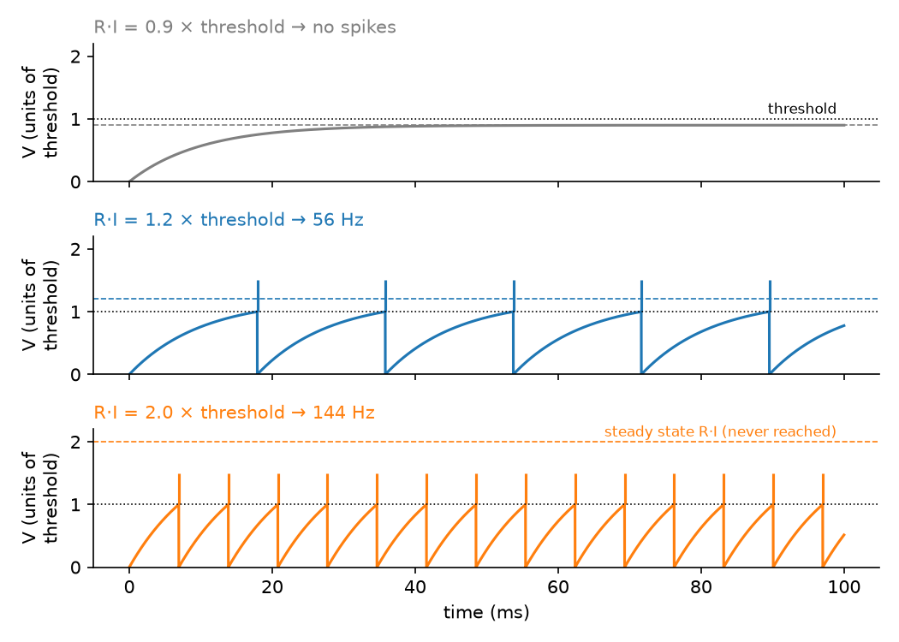

***Figure 5.** Three constant inputs. Dashed line: the steady state $RI$ the neuron is charging towards. Dotted line: threshold. If $RI$ stays below threshold, $V$ saturates and there are no spikes. Above it, $V$ is reset before reaching $RI$. The stronger the input, the faster the charging and the shorter the cycle. **Source:** Simulated here in `make_figures.py` (LIF with $\tau_m$ = 10 ms).*

Plotting the firing rate $f$ against the input strength gives the **f-I curve**:

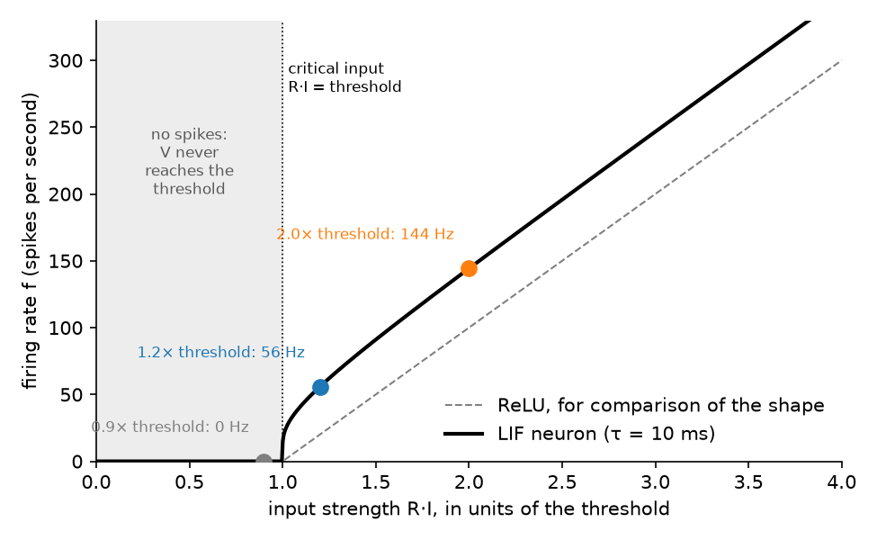

***Figure 6.** Firing rate of an LIF neuron for constant input. The three dots are the three neurons of Figure 5. Below the critical input (grey area), $V$ never reaches the threshold and the neuron stays silent. Above it, the rate rises steeply at first and then almost linearly, the same shape as a ReLU (dashed). **Source:** Computed here from Eq. (8), checked against simulation in `make_figures.py`.*

This shape is why LIF neurons connect to deep learning. [ReLU](https://en.wikipedia.org/wiki/Rectifier_(neural_networks)) is also zero below a threshold and linear above it. A spiking neuron's firing rate behaves like a ReLU activation, which is the basis of ANN-to-SNN conversion (section 8).

<details>
<summary><b>Why the ReLU shape matters:</b> running a trained ANN as a spiking network</summary>

<br>

In rate coding, a spiking neuron receives spikes at rates $r_j$. On average, its input is a weighted sum of these rates, just like in an ANN, and it responds with a rate given by its f-I curve $F$:

$$y = \text{ReLU}\Big(\sum_j w_j x_j + b\Big) \qquad \longleftrightarrow \qquad f = F\Big(\sum_j w_j r_j + b\Big) \tag{7}$$

If $F$ has the shape of a ReLU, a spiking neuron computes the same function as an ANN neuron, with firing rates in place of activations. This holds neuron by neuron, and therefore for the whole network. That's the basis of **ANN-to-SNN conversion**:

1. Train a standard ANN with ReLU activations, using the usual deep learning tools.
2. Copy the weights one to one into a spiking network.
3. Replace each ReLU with a spiking neuron.

The spiking network then produces approximately the same outputs, without training an SNN directly. Each deviation of $F$ from a ReLU is an error that accumulates from layer to layer, so conversion removes the deviations one by one:

- **Leak:** the leak bends the curve near the critical input (Figure 6), so conversion uses neurons without leak (`alpha_decay` = 1).
- **Reset:** reset to a fixed value turns the curve into a staircase, so conversion uses reset by subtraction, which makes the rate exactly input / threshold (section 3, Figure 9).
- **Saturation:** a neuron fires at most once per timestep, while a ReLU is unbounded. The weights are therefore rescaled layer by layer so that no neuron needs to fire faster than that (weight normalisation).

**The price.** A rate can only be read out by counting spikes over many timesteps. Resolving an activation to 1 % takes about 100 steps, which costs latency and spikes, and spikes cost energy. This is why direct training with surrogate gradients (section 8) is often more efficient on neuromorphic hardware: the network learns to get by with few spikes.

</details>

<br>

<details>
<summary><b>Formula:</b> the firing rate as a function of the input</summary>

<br>

The time $T$ from reset (0) to threshold follows from the charging curve, Eq. (6) with $V_0 = 0$ and $V_\infty = RI$: setting $V_\text{th} = RI(1 - e^{-T/\tau_m})$ and solving for $T$ gives

$$T = \tau_m \ln\frac{RI}{RI - V_\text{th}} \quad\text{for } RI > V_\text{th}, \qquad f = \frac{1}{t_\text{ref} + T} \tag{8}$$

with an optional refractory period $t_\text{ref}$ after each spike. This is the curve plotted in Figure 6.

- **At the critical input $RI = V_\text{th}$**, $V$ approaches the threshold but never reaches it: $T \to \infty$, $f = 0$.
- **Just above it**, the neuron fires very slowly, and the rate rises steeply at first. That's why the curve in Figure 6 starts almost vertically.
- **For strong input**, $T \approx \tau_m V_\text{th} / (RI)$, so $f$ grows almost linearly with $I$ (without a refractory period), like a ReLU.
- **With a refractory period**, a neuron can fire at most once per $t_\text{ref}$, so for very strong input the rate saturates at $1/t_\text{ref}$ instead of growing without bound (e.g. 200 Hz for $t_\text{ref}$ = 5 ms).

</details>

<br>

<details>
<summary><b>Worked example:</b> the same in discrete timesteps, as on the chip</summary>

The same in discrete steps, as on the chip (section 3), with `alpha_decay` = 0.9, threshold = 1, reset to 0:

| Input per step | Voltage after each step | Spike after | Rate |
|---|---|---|---|
| 0.1 | 0.1, 0.19, 0.27, … approaches 1.0 but never reaches it | never | 0 |
| 0.2 | 0.2, 0.38, 0.54, 0.69, 0.82, 0.94, **1.04** | 7 steps | 1/7 |
| 0.5 | 0.5, 0.95, **1.36** | 3 steps | 1/3 |

</details>

<br>

Figures are generated by `figures/01_primer_snn_basics/make_figures.py` (`uv run --with numpy --with matplotlib --with schemdraw make_figures.py`), which also checks that the simulated rates match the formula for $T$ and that the fitted LIF fires within 0.3 ms of every HH spike.

**Workshop:** 7 min. One slide with the three models (HH and FitzHugh-Nagumo only as context), then the RC analogy, the spiking figure and the f-I curve. These are the key pictures of the whole basics block.

## 3. LIF in discrete time, as on the chip

SpiNNaker2 computes in discrete timesteps. Solving the LIF equation (5) exactly over one step $\Delta t$ with rest at 0 gives the update used by py-spinnaker2's `lif` model:

$$v[t] = \alpha \, v[t-1] + I_\text{syn}[t] + i_\text{offset}, \qquad \alpha = e^{-\Delta t / \tau_m} \tag{9}$$

<details>
<summary><b>Derivation:</b> from the LIF equation to the update on the chip</summary>

<br>

**Starting point.** Eq. (5) with the resting potential shifted to 0 ($v = V - V_\text{rest}$) and the input written as $u(t) = R\,I(t)$:

$$\tau_m \frac{dv}{dt} = -v + u(t) \tag{10}$$

**Step 1: solve over one timestep.** This is a linear first-order ODE, so it can be solved exactly with an integrating factor. Over one step from $t - \Delta t$ to $t$:

$$\begin{aligned} \tau_m \frac{dv}{ds} &= -v + u(s) \\ \frac{dv}{ds} + \frac{v}{\tau_m} &= \frac{u(s)}{\tau_m} \\ e^{s/\tau_m}\frac{dv}{ds} + \frac{e^{s/\tau_m}}{\tau_m}\,v &= \frac{e^{s/\tau_m}}{\tau_m}\,u(s) \\ \frac{d}{ds}\left(e^{s/\tau_m}\, v(s)\right) &= \frac{e^{s/\tau_m}}{\tau_m}\,u(s) \\ \int_{t-\Delta t}^{t} \frac{d}{ds}\left(e^{s/\tau_m}\, v(s)\right) ds &= \frac{1}{\tau_m}\int_{t-\Delta t}^{t} e^{s/\tau_m}\, u(s)\, ds \\ e^{t/\tau_m}\, v(t) - e^{(t-\Delta t)/\tau_m}\, v(t-\Delta t) &= \frac{1}{\tau_m}\int_{t-\Delta t}^{t} e^{s/\tau_m}\, u(s)\, ds \\ v(t) &= e^{-\Delta t/\tau_m}\, v(t-\Delta t) + \frac{1}{\tau_m}\int_{t-\Delta t}^{t} e^{-(t-s)/\tau_m}\, u(s)\, ds \\ s &= t - \Delta t + s', \quad ds = ds', \quad s\big|_{t-\Delta t}^{t} \;\to\; s'\big|_{0}^{\Delta t}, \quad t - s = \Delta t - s' \\ v(t) &= e^{-\Delta t/\tau_m}\, v(t-\Delta t) + \frac{1}{\tau_m}\int_{0}^{\Delta t} e^{-(\Delta t-s')/\tau_m}\, u(t-\Delta t+s')\, ds' \\ v(t) &= \underbrace{e^{-\Delta t/\tau_m}}_{\alpha}\, v(t-\Delta t) + \frac{1}{\tau_m}\int_{0}^{\Delta t} e^{-(\Delta t-s)/\tau_m}\, u(t-\Delta t+s)\, ds \end{aligned} \tag{11}$$

The first term is the old value, decayed for one step. The integral collects the input received during the step, where input from early in the step has decayed more than input from late in the step.

**Step 2: constant input → `i_offset`.** For a constant input $u$, the integral in Eq. (11) is a fixed amount per step, the bias term `i_offset`:

$$\begin{aligned} u(t - \Delta t + s) &= u = \text{const} \\ \frac{1}{\tau_m}\int_{0}^{\Delta t} e^{-(\Delta t-s)/\tau_m}\, u\, ds &= \frac{u}{\tau_m}\, e^{-\Delta t/\tau_m} \int_{0}^{\Delta t} e^{s/\tau_m}\, ds \\ &= \frac{u}{\tau_m}\, e^{-\Delta t/\tau_m}\, \tau_m \left(e^{\Delta t/\tau_m} - 1\right) \\ &= u \left(1 - e^{-\Delta t/\tau_m}\right) \\ &= (1 - \alpha)\, u \;\equiv\; i_\text{offset} \end{aligned} \tag{12}$$

**Step 3: input spikes → `I_syn`.** A spike makes $v$ jump by its weight $w$. As an input, this is a delta pulse whose area is chosen so that the jump is exactly $w$. The spikes arriving in one step, at times $s_k$ within the step, then contribute:

$$\begin{aligned} \tau_m \frac{dv}{ds} &= \tau_m\, w\, \delta(s - s_k) \;\Rightarrow\; v(s_k^+) - v(s_k^-) = \int_{s_k^-}^{s_k^+} w\, \delta(s - s_k)\, ds = w \\ u(t - \Delta t + s) &= \tau_m \sum_k w_k\, \delta(s - s_k), \qquad 0 < s_k \le \Delta t \\ \frac{1}{\tau_m}\int_{0}^{\Delta t} e^{-(\Delta t-s)/\tau_m}\, \tau_m \sum_k w_k\, \delta(s - s_k)\, ds &= \sum_k w_k\, e^{-(\Delta t - s_k)/\tau_m} \\ s_k = \Delta t \;\Rightarrow\; \sum_k w_k\, e^{0} &= \sum_k w_k \;\equiv\; I_\text{syn}[t] \end{aligned} \tag{13}$$

The last line is the chip's simplification: arrival times within a step aren't resolved, so every spike of a step counts as arriving at its end and contributes its full weight.

**Result.** Writing $v[t]$ for $v(t)$ at the end of step $t$ and combining the three terms gives Eq. (9):

$$v[t] = \alpha\, v[t-1] + I_\text{syn}[t] + i_\text{offset} \tag{14}$$

**Why not simply Euler?** The forward Euler method, $v[t] = v[t-1] + \frac{\Delta t}{\tau_m}\left(-v[t-1] + u\right)$, gives the same form with $\alpha_\text{Euler} = 1 - \Delta t/\tau_m$. This matches $e^{-\Delta t/\tau_m}$ only for $\Delta t \ll \tau_m$, and it becomes unstable (negative $\alpha$) for $\Delta t > \tau_m$. The exact solution is correct for any step size, which is why coarse steps of about 1 ms work for LIF.

</details>

<br>

- `alpha_decay` = $\alpha$ in $[0, 1]$. For $\Delta t$ = 1 ms: $\tau_m$ = 10 ms gives $\alpha \approx 0.905$, $\tau_m$ = 15 ms gives $\alpha \approx 0.936$. $\alpha$ = 1 means no leak (pure integrate-and-fire), $\alpha$ = 0 means no memory at all.
- `I_syn[t]` is the sum of the weights of all spikes arriving in this step.
- `i_offset` is a constant bias current.
- `threshold`, `v_init`: as expected. Resting potential is 0, and everything is in dimensionless units.
- `reset`: `reset_by_subtraction` (default, $v \leftarrow v - \text{threshold}$) keeps the leftover charge, so the firing rate tracks the input more faithfully. This is preferred for ML and ANN conversion. `reset_to_v_reset` ($v \leftarrow$ `v_reset`) is the textbook version.

Each step does three things: decay the old value by $\alpha$, add the input of this step, and compare with the threshold.

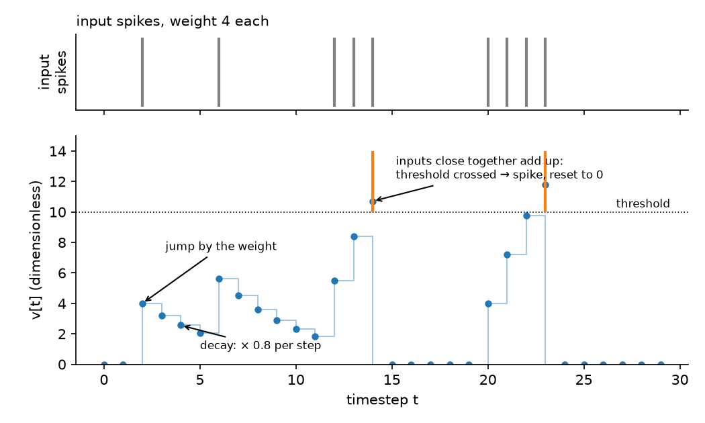

***Figure 7.** Eq. (9) step by step, with `alpha_decay` = 0.8, `threshold` = 10 and reset to 0. Top: arrival times of input spikes. Each spike makes $v$ jump by its weight, and between spikes $v$ shrinks by the factor 0.8 per step. Isolated spikes (steps 2 and 6) mostly leak away before the next one arrives. Spikes close together (steps 12–14 and 20–23) add up, cross the threshold and trigger an output spike (orange), after which $v$ restarts from 0. **Source:** Simulated here in `make_figures.py` with the update rule documented for py-spinnaker2 v0.8, not yet run on the chip.*

<details>
<summary><b>Choosing <code>alpha_decay</code>:</b> how it sets the memory of the neuron</summary>

<br>

`alpha_decay` sets how long the neuron remembers an input: after $n$ steps, a fraction $\alpha^n$ of it is left. The number of steps until $1/e$ is left is the time constant in units of steps, $\tau_m / \Delta t = -1/\ln\alpha$.

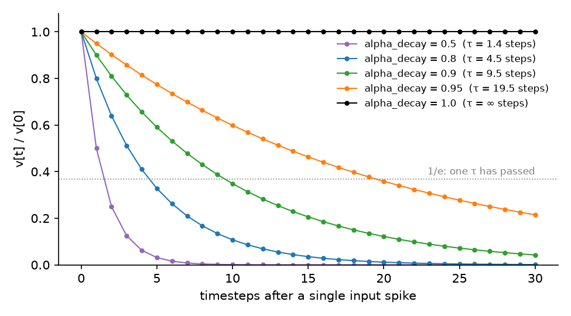

***Figure 8.** Decay of $v$ after a single input spike, for different values of `alpha_decay`. Values close to 1 give a long memory (the neuron integrates over many steps), small values a short one (only nearly coincident inputs add up). `alpha_decay` = 1 means no leak at all. **Source:** Computed here: $v[t]/v[0] = \alpha^t$.*

</details>

<br>

<details>
<summary><b>Reset modes:</b> where the overshoot goes, and why it matters for ANN conversion</summary>

<br>

The two reset modes differ in what happens to the charge above the threshold. With `reset_by_subtraction`, the overshoot is carried over to the next cycle. With `reset_to_v_reset`, it's lost.

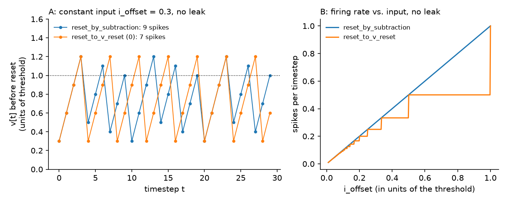

***Figure 9.** A: the same constant input with both reset modes, without leak. After a reset by subtraction, $v$ keeps the overshoot (e.g. 1.2 − 1 = 0.2), so the next spike comes sooner. After a reset to 0 the overshoot is lost. B: as a result, the firing rate with reset by subtraction is exactly proportional to the input (input / threshold spikes per step), like a ReLU. With reset to 0 it's a staircase that lies below it, because each cycle needs a whole number of steps. **Source:** Simulated here in `make_figures.py` with the update rule documented for py-spinnaker2 v0.8, not yet run on the chip.*

- **Reset by subtraction** carries the overshoot into the next cycle. No input is lost, so on average the rate is exactly input / threshold.
- **Reset to a fixed value** discards the overshoot, so every cycle takes a whole number of steps and the rate drops to the staircase in Figure 9B.

**Why this matters for ML.** In ANN-to-SNN conversion, the firing rate of each spiking neuron has to reproduce an ANN activation, the output of a ReLU. With reset by subtraction the rate is proportional to the input. With reset to a fixed value, every neuron makes a rounding error, and these errors accumulate from layer to layer.

**Why "textbook version".** Biological neurons, and the classic LIF model, return to a fixed value after each spike, however strong the input was. HH, for example, always drops back to about −75 mV (Figure 1).

</details>

<br>

The neuron parameters are per step and have no unit: $\tau_m$ only enters through `alpha_decay`, so what one step means in model time is a modelling choice. The clustered network example, for instance, reads one step as 1 ms. On the chip, each step is in addition a real interval of wall-clock time, started by a hardware timer: `hw.run(net, 50, sys_tick_in_s=1e-3)` runs 50 steps of 1 ms each, and 1 ms is the default (py-spinnaker2, simulation options). `sys_tick_in_s` doesn't change the dynamics, only how much real time each PE has per step to do its work (`02_hardware_energy.md`, section 7).

<details>
<summary><b>Note on units:</b> why every model uses different numbers, and how to map physical values onto the chip</summary>

<br>

Each neuron model comes with its own system of units, so input values are not comparable across models. In the model comparison of section 2 (Figure 1):

| Model | Input | Units |
|---|---|---|
| Hodgkin-Huxley | $I_0$ = 10 µA/cm² | Physical, per unit membrane area: $C_m$ = 1 µF/cm², conductances in mS/cm². With $C_m\,dV/dt = I - I_\text{ion}$, 10 µA/cm² initially raises $V$ by 10 mV/ms. |
| FitzHugh-Nagumo | $I_0$ = 0.5 | Dimensionless: $v$, $w$ and time are rescaled so all units drop out. No fixed conversion to physical values exists. |
| LIF | $R I_0$ = 62 mV | The input is written as a voltage: $R I$ is where $V$ would settle above rest without a threshold. |
| SpiNNaker2 | `threshold`, weights, `i_offset` | Dimensionless, like FitzHugh-Nagumo. |

Physical units can be converted into each other. With $C_m$ = 1 µF/cm² and $\tau_m$ = 10 ms, the LIF resistance is $R = \tau_m / C_m$ = 10 kΩ·cm², so $R I_0$ = 62 mV corresponds to $I_0$ = 6.2 µA/cm², the same order of magnitude as HH's 10 µA/cm². (They differ because the LIF was fitted to HH's spike times, not to its input.)

**Mapping a physical LIF onto the chip.** Choose two scales: the duration of one timestep $\Delta t$ and a voltage unit $U$. For example, `threshold` = 1 could stand for 10 mV above rest. Then:

- `alpha_decay` $= e^{-\Delta t / \tau_m}$
- A constant input $R I$ becomes `i_offset` $= (1 - \alpha)\, R I / U$. This follows from integrating the ODE exactly over one step (Eq. (12) in the derivation), and it gives the correct steady state: `i_offset` $/ (1 - \alpha) = R I / U$.
- A synaptic weight $w$ makes $v$ jump by $w$ units, i.e. by $w \cdot U$ in physical terms. It is the height of the voltage step a single input spike causes.

**What actually matters are ratios**, not absolute values:

- input relative to the critical input: does the neuron fire at all, and how fast?
- weight relative to threshold: `threshold / weight` is roughly the number of coincident input spikes needed to make the neuron fire
- $\tau_m$ relative to $\Delta t$: how many steps the neuron remembers

With integer weights this becomes a design decision. On a model with weights in [−15, 15], a threshold of 15 lets a single strong spike trigger a neuron. A threshold of 150 needs at least ten coincident spikes, but gives finer control over how much each input contributes.

</details>

<br>

**Workshop:** 5 min, this equation is what participants set parameters for in hands-on 1. Show the conversion $\tau \to \alpha$.

## 4. Synapses

A **synapse** connects a presynaptic neuron to a postsynaptic one and has a **weight** (positive = excitatory, negative = inhibitory) and a **delay** (steps until the spike arrives). In py-spinnaker2, a connection is `[pre_index, post_index, weight, delay]`, and the effective delay is `delay + 1`, because a spike is processed in the step after it's emitted.

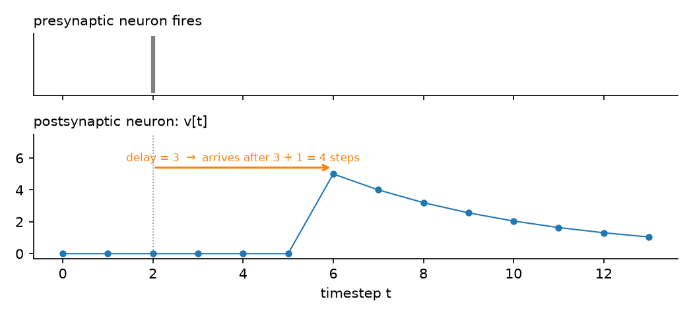

***Figure 10.** A presynaptic spike at step 2, sent through a connection with `delay` = 3, reaches the postsynaptic neuron at step 6. There, $v$ jumps by the weight (here 5) and then decays with `alpha_decay` = 0.8. **Source:** Simulated here in `make_figures.py` with the update rule documented for py-spinnaker2 v0.8, not yet run on the chip.*

Two synapse types on the chip:

- **Instantaneous (delta) synapses** (`lif`): each arriving spike increases $v$ immediately by its weight. Simple, one state variable per neuron.
- **Current-based exponential synapses** (`lif_curr_exp`): each spike adds to a synaptic current that decays with its own time constant, and that current feeds $v$. Separate excitatory and inhibitory currents with decays `exc_decay`, `inh_decay`:

$$I_\text{exc}[t] = \beta_e I_\text{exc}[t-1] + \textstyle\sum w_\text{exc}, \quad I_\text{inh}[t] = \beta_i I_\text{inh}[t-1] + \textstyle\sum |w_\text{inh}|, \quad v[t] = \alpha v[t-1] + I_\text{exc}[t] - I_\text{inh}[t] + i_\text{offset} \tag{15}$$

  This smooths the input over time and is closer to biology. The clustered network example uses it.

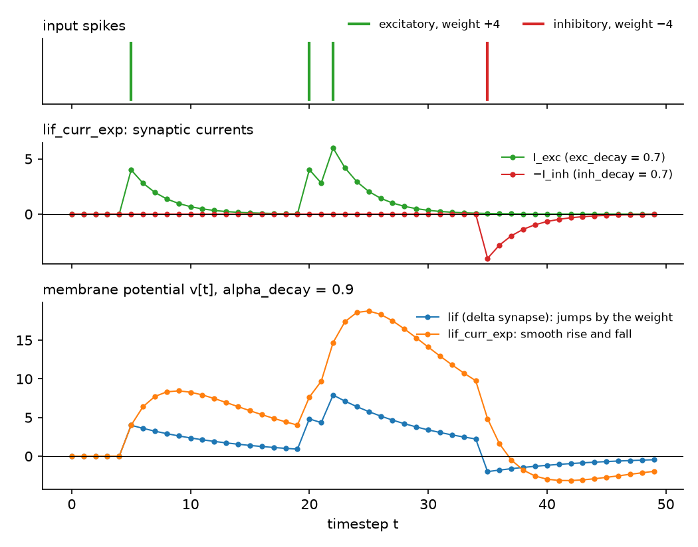

***Figure 11.** The same input spikes into both synapse types. With delta synapses (`lif`, blue), each spike makes $v$ jump by its weight. With exponential synapses (`lif_curr_exp`), each spike first raises a synaptic current that decays over a few steps (middle), and $v$ integrates this current, so it rises and falls smoothly (orange). Two spikes close together (steps 20 and 22) add up in both cases. For the same weight, the exponential synapse has a larger total effect, because the current keeps feeding $v$ for several steps. Weights therefore need to be scaled differently between the two models. **Source:** Simulated here in `make_figures.py` with the update rule documented for py-spinnaker2 v0.8, not yet run on the chip.*

<details>
<summary><b>Delta vs. exponential synapses:</b> what happens after a spike arrives, and when to use which</summary>

<br>

**Two stages.** A spike first travels to its target: emitted in step $t$, it arrives in step $t + \text{delay} + 1$ (Figure 10). The synapse type only decides what happens *after* the arrival.

**Delta synapse** (`lif` and its variants). The spike acts completely within its arrival step: $v[t] = \alpha\, v[t-1] + \sum w$. Afterwards only the leak acts, so $n$ steps after the arrival the spike's contribution is $w\,\alpha^n$. One state variable per neuron ($v$).

**Exponential synapse** (`lif_curr_exp` and its variants). The spike first increases a synaptic current, which then feeds $v$ over the following steps:

- $I_\text{exc}[t] = \beta_e\, I_\text{exc}[t-1] + \sum w_\text{exc}$, with `exc_decay` $= \beta_e = e^{-\Delta t/\tau_\text{syn}}$, and the same for the inhibitory current with `inh_decay`
- $v[t] = \alpha\, v[t-1] + I_\text{exc}[t] - I_\text{inh}[t] + i_\text{offset}$

So $v$ rises over a few steps, peaks, and falls again (Figure 11). This models the fact that biological synaptic currents last a few milliseconds. Excitatory and inhibitory currents have their own time constants, e.g. 3 ms and 5 ms in the clustered network example. Three state variables per neuron ($v$, $I_\text{exc}$, $I_\text{inh}$).

**Same weight, different effect.** The current keeps feeding $v$ for several steps, so the total effect of one spike is larger by a factor of about $1/(1 - \beta)$, i.e. 3.3 for $\beta$ = 0.7. Weights can't be copied between the two models without rescaling.

**Which is the default?** py-spinnaker2 has no default: every `Population` names its `neuron_model` explicitly. `lif` (delta synapses) is the basic model used throughout the tutorials.

**When to use which:**

| | Delta synapse (`lif`) | Exponential synapse (`lif_curr_exp`) |
|---|---|---|
| Response to a spike | immediate jump | gradual rise and fall |
| Sensitivity to timing | high: inputs only add up if they arrive within about $\tau_m$ | lower: the current bridges gaps of about $\tau_\text{syn}$ |
| State per neuron | 1 variable | 3 variables |
| Typical use | ANN-to-SNN conversion, simple networks, precise coincidence detection | biologically inspired networks (e.g. the clustered network), models trained with current-based LIF neurons |

For models trained elsewhere, the neuron type must match: a model trained with current-based LIF neurons (e.g. snnTorch's `Synaptic` neuron, or `CubaLIF` in NIR) needs exponential synapses on the chip. How py-spinnaker2's NIR import maps these types is still to be checked.

</details>

<br>

**Weights are small integers.** This is the biggest practical constraint for ML people, and it depends on the model variant:

| Model variant | Weights | Delays | Note |
|---|---|---|---|
| `lif`, `lif_curr_exp`, `alif` | 5 bit, [-15, 15] | 0–7 | default |
| `*_no_delay` | 8 bit, [-127, 127] | 0 only | precision instead of delays |
| `*_no_delay_1024` | 5 bit, [-31, 31] | 0 only | 1024 neurons per core |
| `*_32bit` | 20 bit | 0–7 | more precision, more memory |
| `lif_conv2d` | 8 bit, [-128, 127] | 0 only | convolutional layers |

Weights outside the range are clipped and rounded toward zero. The trade-off between weight precision, delays and neurons per core comes from limited memory per core. It's a good example of hardware shaping the model.

Weights trained as floating-point numbers therefore have to be mapped onto these few integers. A common approach: multiply by a scale factor so that the largest weights land near the edge of the range, then round.

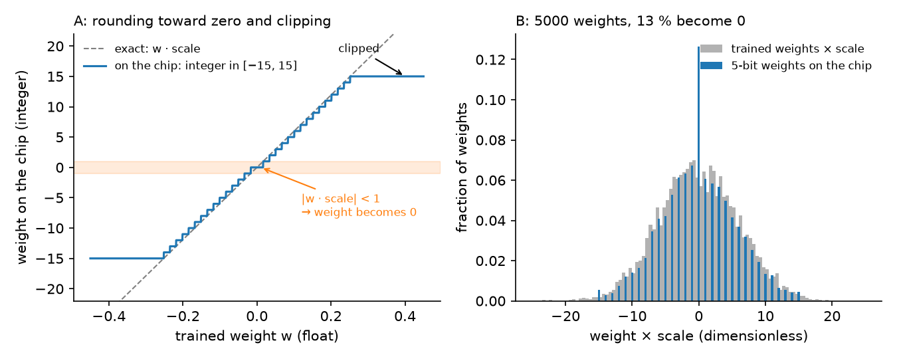

***Figure 12.** Mapping 5000 normally distributed "trained" weights onto the 5-bit range [−15, 15]. A: the scale is chosen so that 99 % of the weights fit into the range. The rest is clipped to ±15. Rounding toward zero maps everything with $|w \cdot \text{scale}| < 1$ to 0. B: as a result, 13 % of the weights become 0, i.e. the connection disappears, and the remaining weights take only 30 distinct values. A larger scale keeps more small weights but clips more large ones. This trade-off is why quantisation-aware training helps (section 8). **Source:** Synthetic, normally distributed weights, quantised here with the rounding and clipping rule documented for py-spinnaker2 v0.8, not yet run on the chip.*

**Workshop:** 5 min, weight and delay, excitatory and inhibitory, the quantisation table.

## 5. Other neuron models on the chip

- **ALIF (adaptive LIF):** the threshold rises by `threshold_adp_inc` after each spike and decays back with `threshold_adp_decay`. The neuron gets "tired", and the adaptation variable keeps a memory much longer than $\tau_m$. This matters for ML: networks with adaptive neurons (LSNNs, Bellec et al. 2018) handle tasks with long time dependencies. **Used for:** recurrent SNNs on tasks with long time dependencies, e.g. keyword spotting or sequence classification.

<details>
<summary><b>Figure 13:</b> LIF vs. ALIF under the same input</summary>

<br>

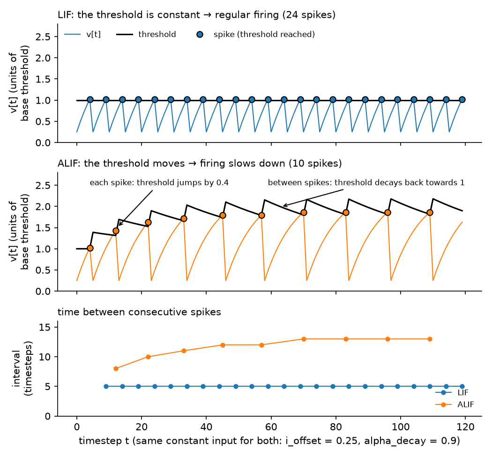

***Figure 13.** The same constant input into an LIF neuron (top) and an ALIF neuron (middle), both reset to 0 after a spike. The only difference is the threshold (black). In LIF it is constant, so every cycle takes the same time and the neuron fires regularly. In ALIF, every spike raises the threshold by `threshold_adp_inc` = 0.4, and between spikes it decays back towards 1 with `threshold_adp_decay` = 0.97. The neuron needs longer and longer to reach the raised threshold, so the intervals between spikes grow (bottom) until the increase per spike balances the decay (spike-frequency adaptation). The raised threshold stores information about recent activity for many steps, much longer than $v$ itself. **Source:** Simulated here in `make_figures.py` with the update rule documented for py-spinnaker2 v0.8, not yet run on the chip. Reset to 0 instead of the default reset by subtraction, for clarity.*

</details>

<br>

- **Izhikevich:** two variables with a quadratic term. Cheap, yet reproduces many biological firing patterns (bursting, chattering). Mainly for neuroscience. **Used for:** computational neuroscience, e.g. large simulations of cortical networks with diverse neuron types. Rarely in ML.

<details>
<summary><b>Figure 14:</b> firing patterns of the Izhikevich model</summary>

<br>

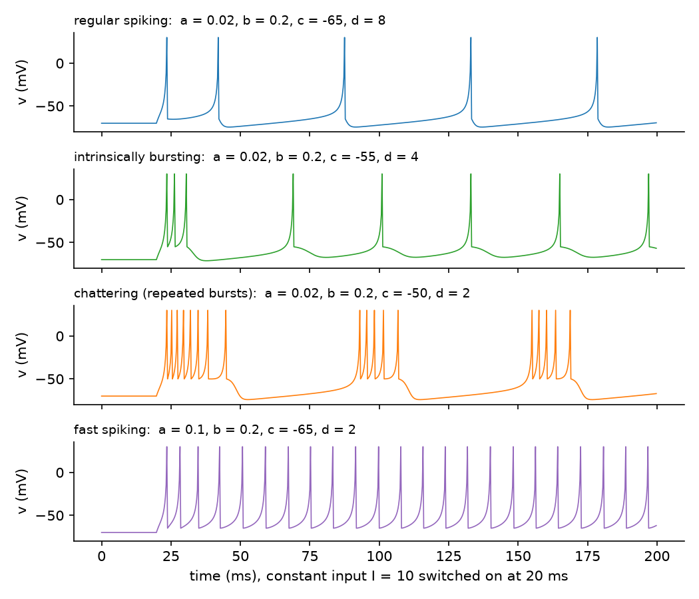

***Figure 14.** The Izhikevich model with four parameter sets from Izhikevich (2003), all driven by the same constant input. Only the four parameters $a, b, c, d$ differ: $a$ and $b$ set the time scale and sensitivity of the recovery variable $u$, $c$ is the reset value of $v$, and $d$ the increase of $u$ after each spike. Regular spiking slows down over time like ALIF, bursting neurons fire groups of spikes, fast-spiking neurons fire at a high, constant rate. **Source:** Simulated here in `make_figures.py` with the parameter sets of Izhikevich (2003), in physical units (mV, ms) with 0.25 ms steps as in the original model, not yet run on the chip.*

</details>

<br>

- **Probabilistic LIF** (`lif_prob`): spikes with probability `firing_prob` once above threshold. Noise as a feature, for sampling and optimisation. **Used for:** stochastic computing, e.g. sampling from probability distributions or escaping local minima in optimisation.

<details>
<summary><b>Figure 15:</b> probabilistic vs. deterministic firing</summary>

<br>

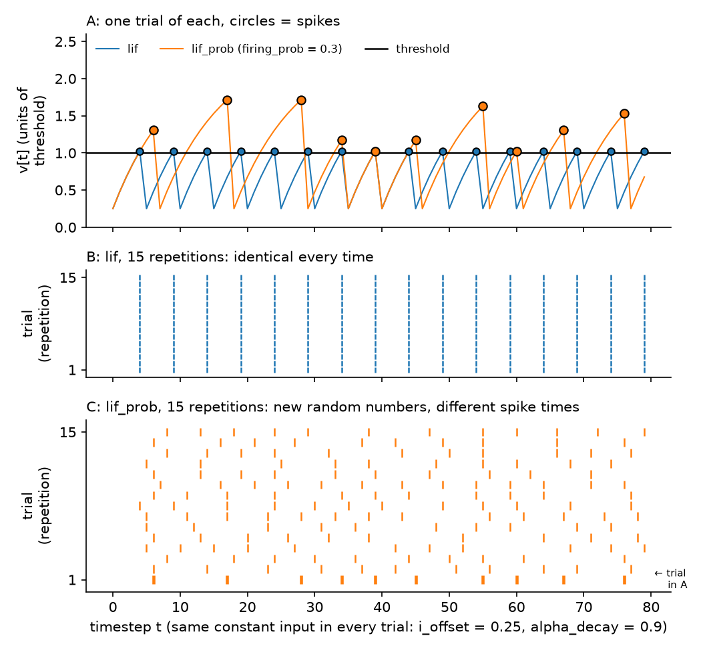

***Figure 15.** A deterministic `lif` neuron and a probabilistic `lif_prob` neuron (`firing_prob` = 0.3) with the same constant input. A: one trial of each. `lif` (blue) fires as soon as $v$ reaches the threshold. `lif_prob` (orange) flips a coin in every step above the threshold and fires only with probability 0.3. Until it does, $v$ keeps integrating, so it can climb well above the threshold. B and C: 15 trials, i.e. repetitions of the same simulation with the same input. `lif` fires at exactly the same times in every trial (B, the same times as in A). `lif_prob` draws new random numbers in each trial, so the spike times differ (C, the thick row, trial 1, is the trial from A). The randomness is intended: networks of such neurons can sample from probability distributions, and noise helps optimisation escape poor solutions. **Source:** Simulated here in `make_figures.py` with the update rule documented for py-spinnaker2 v0.8, not yet run on the chip. What happens to $v$ above the threshold without a spike is not documented: the figure assumes it keeps integrating.*

</details>

<br>

- **QUBO neuron:** specialised for solving optimisation problems (QUBO Max-Cut example). **Used for:** combinatorial optimisation problems (Max-Cut, graph colouring, scheduling), where the network dynamics settle into good solutions.

<details>
<summary><b>QUBO in more detail:</b> the problem, how the neurons solve it, and when to use them</summary>

<br>

**The problem.** [QUBO](https://en.wikipedia.org/wiki/Quadratic_unconstrained_binary_optimization) (quadratic unconstrained binary optimisation) means finding binary variables $x_i \in \{0, 1\}$ that minimise a quadratic function:

$$E(x) = \sum_{i,j} Q_{ij}\, x_i x_j \tag{16}$$

**Reading the matrix $Q$.** Because $x_i^2 = x_i$ for binary variables, the diagonal entries $Q_{ii}$ act as a linear cost for switching $x_i$ on, and each off-diagonal entry $Q_{ij}$ is a cost that only arises when both $x_i$ and $x_j$ are 1. Positive entries penalise, negative entries reward. The off-diagonal part has the structure of a graph's adjacency matrix: variables are nodes, non-zero $Q_{ij}$ are edges.

Many hard combinatorial problems can be written in this form: Max-Cut, graph colouring, scheduling, portfolio selection and, with penalty terms, the travelling salesman problem. For **Max-Cut**, the edge between nodes $i$ and $j$ is cut exactly when $x_i \neq x_j$, i.e. when $x_i + x_j - 2x_i x_j = 1$. Maximising the number of cut edges, $\sum_{(i,j)} (x_i + x_j - 2x_i x_j)$, is the same as minimising its negative, which has the form of Eq. (16). Max-Cut appears in chip layout (partitioning circuits), community detection in networks, image segmentation and, in physics, as the ground state of spin glasses, and it is a standard benchmark for comparing classical, quantum and neuromorphic solvers. Most are [NP-hard](https://en.wikipedia.org/wiki/NP-hardness), so in practice the goal is a good solution, not a guaranteed optimum. 

**Connection to physics.** In physics, binary variables are usually written as spins $s_i \in \{-1, +1\}$ (spin down or up) instead of $x_i \in \{0, 1\}$. The substitution $x_i = (s_i + 1)/2$ maps $x_i = 0$ to $s_i = -1$ and $x_i = 1$ to $s_i = +1$. Inserted into Eq. (16), it turns $E$ into the energy of the [Ising model](https://en.wikipedia.org/wiki/Ising_model), $E = \sum_{i,j} J_{ij}\, s_i s_j + \sum_i h_i\, s_i + \text{const}$, with couplings $J_{ij} = Q_{ij}/4$ and local fields $h_i$ given by sums over $Q$. Minimising $E$ therefore means finding the lowest-energy spin configuration (the ground state) of a [spin glass](https://en.wikipedia.org/wiki/Spin_glass), and methods from statistical physics such as annealing apply directly.

**How QUBO neurons solve it.** The `qubo_neuron` model of py-spinnaker2 updates its state as

$$v[t] = \alpha\, v[t-1] \;-\; 0.1\, I_\text{syn}[t] \;-\; 0.15\, v[t-1]\left(v[t-1]^2 - 1\right) \;+\; \text{noise} \tag{17}$$

The first two terms are familiar from LIF: decay and synaptic input (here with a negative sign, so excitatory input pushes $v$ down). The cubic term is new: it pulls $v$ towards $+1$ or $-1$, whichever is closer, so each neuron has two stable states (Figure 16A). The noise lets it jump between them. The problem is mapped onto a network of such neurons whose dynamics drive $E$ down:

- **One neuron per variable.** The double well gives each neuron two stable states, 0 and 1 (Figure 16A).
- **Weights encode $Q$.** The coupling between two neurons represents $Q_{ij}$. In Max-Cut, neighbours push each other into opposite states.
- **Noise acts as temperature.** Strong noise early on lets the network escape poor configurations. It then decreases, like [simulated annealing](https://en.wikipedia.org/wiki/Simulated_annealing), but carried out by physical dynamics instead of an algorithm.
- **Readout.** After the network has settled, the neuron states are the solution.

The underlying idea, computing by relaxing into an energy minimum, is the same as in [Hopfield networks](https://en.wikipedia.org/wiki/Hopfield_network) and [Boltzmann machines](https://en.wikipedia.org/wiki/Boltzmann_machine).

**When to use them.** For combinatorial optimisation where good solutions are needed quickly and energy-efficiently, especially for sparse problems in which each variable interacts with only a few others, since these map well onto neuromorphic hardware. Neuromorphic chips compete here with quantum annealers (D-Wave) and digital annealers (Fujitsu). So far there is little evidence that neuromorphic QUBO solvers beat good classical solvers such as simulated annealing on a CPU. It is an active research topic, not yet an established tool.

**Why it matters for the workshop.** QUBO shows that neuromorphic hardware is not limited to neural networks: it can compute directly with dynamics. py-spinnaker2 ships a ready-made QUBO Max-Cut example, which makes it a low-effort demo, and it connects to the energy argument (many small, parallel, event-based updates instead of a sequential algorithm). Suitable as a short outlook (at most 5 min), not as a hands-on part.

</details>

<br>


<details>
<summary><b>Figure 16:</b> QUBO neurons solving a small Max-Cut problem</summary>

<br>

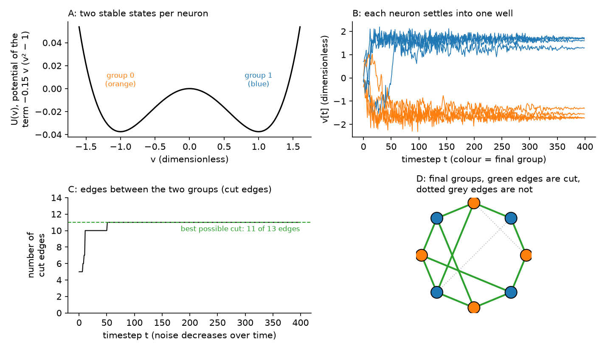

***Figure 16.** Principle of the QUBO neuron on a small [Max-Cut](https://en.wikipedia.org/wiki/Maximum_cut) problem. The task: split the nodes of a graph into two groups so that as many edges as possible run between the two groups. Such edges are called *cut edges*, because a line separating the groups would cut through them. A: the cubic term of Eq. (17) acts like the force of a double-well potential $U(v)$, so each neuron settles near $v = -1$ or $v = +1$. This represents the group its node belongs to. B: one neuron per node, coupled to its neighbours so that neighbours are pushed into opposite groups. Strong noise early on lets the network escape poor configurations, and it decreases over time. The coupling also pushes the states somewhat beyond ±1. C: the number of cut edges grows until it reaches the best possible value, 11 of 13 edges, checked here by trying all 256 partitions. Not all edges can be cut, because the graph contains odd cycles such as triangles: around an odd cycle, the two groups can't alternate, so at least one of its edges stays uncut. D: the final groups (blue, orange) and the cut edges (green). **Source:** Illustration simulated here in `make_figures.py`: update equation (17) with $\alpha$ = 1 and a simplified continuous coupling instead of the chip's spike-based coupling, not run on the chip. The optimal cut is computed exactly by trying all partitions.*

</details>

<br>

- Custom models can be written in C (advanced topic, not for the workshop). Docs: [tutorial 09, custom neuron models basics](https://spinnaker2.gitlab.io/py-spinnaker2/tutorials/deep_dive/09_custom-neuron-models_basics.html) and the [custom model guide](https://spinnaker2.gitlab.io/py-spinnaker2/advanced_topic/custom_model/index.html), with the [C backend](https://spinnaker2.gitlab.io/py-spinnaker2/advanced_topic/custom_model/custom-model-guide-hw.html) and the [Python frontend](https://spinnaker2.gitlab.io/py-spinnaker2/advanced_topic/custom_model/custom-model-guide-py.html). **Used for:** research on new neuron models or learning rules.

**Workshop:** 1 min, name them, show that the chip is programmable and not fixed to one model.

## 6. Getting data in and out

Inside the network, all information is carried by spikes. Data from outside (images, sensor values, audio) therefore has to be *encoded* into spikes, and the network's output *decoded* back into numbers.

<details>
<summary><b>What is neural coding?</b> how information can be written into spikes</summary>

<br>

A spike is always the same all-or-nothing event, so a single spike carries almost no information on its own. The information lies in the *pattern* of spikes. The main ways of reading it ([neural coding](https://en.wikipedia.org/wiki/Neural_coding)):

- **Rate coding:** how many spikes a neuron fires in a time window. Example: a bright pixel makes its input neuron fire often.
- **Temporal coding:** *when* a neuron fires. This is an umbrella term: the information can lie in the time of the first spike, the intervals between spikes, or precise spike patterns. **Latency coding** is the simplest case: only the time of the first spike counts, e.g. a bright pixel makes its neuron fire early.
- **Population coding:** *which* neurons are active together. A value is represented by the pattern across many neurons, e.g. each neuron responds best to a different direction of motion.

The brain uses all of these, depending on the brain area and the task. On a chip, the choice is a design decision with a clear trade-off: rate codes are robust against noise but need many spikes (time and energy), temporal codes are sparse and fast but sensitive to precise timing.

</details>

<br>

Encoders available on the chip, with the brightness $x \in [0, 1]$ of an image pixel as example input:

- **Rate coding** (`poisson_process`): the brighter, the more often the neuron fires. In each step it fires with probability `p`, e.g. $p = 0.25\,x$ ([Poisson process](https://en.wikipedia.org/wiki/Poisson_point_process)). Robust, but reading the value back needs many steps and spikes (Figure 18).
- **Latency coding** (`spikes_from_array_latency_code`): the brighter, the earlier the neuron fires, exactly once: $t = t_\text{max}(x_\text{max} - x)/x_\text{max}$, with $t_\text{max}$ the latest spike time and $x_\text{max}$ the largest input value. Very sparse, but sensitive to timing errors.
- **Explicit spike times** (`spike_list`): the spike times are given directly, e.g. `{0: [1, 2, 3], 5: [20, 30]}` lets neuron 0 fire at steps 1–3 and neuron 5 at steps 20 and 30. Used in the tutorials and for data that already exists as spikes.
- **[Event cameras](https://en.wikipedia.org/wiki/Event_camera) (DVS)** produce spike-like events themselves, so no encoding is needed. Datasets recorded with them, such as NMNIST and DVS Gesture, are the standard neuromorphic benchmarks.

<details>
<summary><b>Event cameras and neuromorphic datasets:</b> DVS, NMNIST and DVS Gesture</summary>

<br>

**Event cameras.** A conventional camera sends complete frames at a fixed rate, even if nothing in the image changes. An event camera, or dynamic vision sensor (DVS), works like a retina: each pixel works independently and reports only when its brightness *changes*. A change produces an *event* with the pixel position, a timestamp with microsecond resolution, and a polarity (brighter = ON, darker = OFF). A static scene produces almost no data, a moving edge produces a stream of events. This output is already a spike train, so it can be fed into an SNN without encoding: each pixel and polarity becomes one input neuron, and the events are collected into the chip's timesteps.

**Standard datasets:**

- **NMNIST** (Orchard et al. 2015): the MNIST handwritten digits, recorded with a DVS that moves in small saccades in front of a screen showing the digits. 34 × 34 pixels, 10 classes. The "hello world" of neuromorphic vision, and the dataset of the pre-trained NIR example in py-spinnaker2.
- **DVS Gesture** (Amir et al. 2017, IBM): 11 hand and arm gestures (e.g. clapping, waving) of 29 people, recorded with a 128 × 128 DVS. Harder than NMNIST, because the information lies in the motion over time.

</details>

<br>


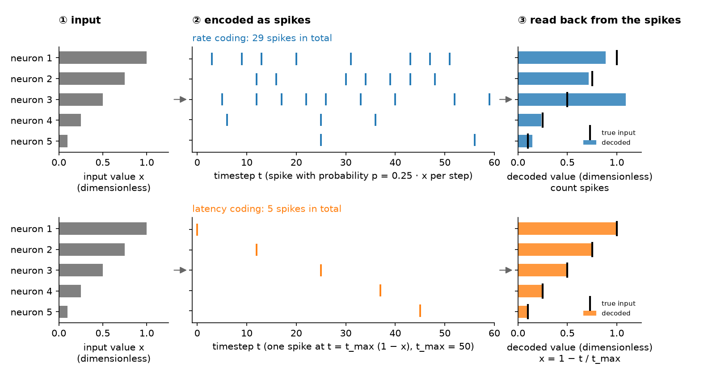

***Figure 17.** The full path from values to spikes and back, for rate coding (top) and latency coding (bottom). ① Five input neurons, each with a value to encode. ② The spikes each neuron produces, one tick per spike. Rate coding (`poisson_process`, $p = 0.25\,x$, 3 steps refractory period): larger values give more spikes on average, at random times. Latency coding (`spikes_from_array_latency_code`): one spike per neuron, and the larger the value, the earlier. ③ The values read back from the spikes (bars) compared with the true inputs (black lines). Rate coding recovers them only roughly after 60 steps: neuron 3 happened to fire more often than neuron 1, and its value is overestimated (Figure 18 shows how the error shrinks with longer windows). Latency coding recovers them almost exactly, with 5 spikes instead of 29. The price is that the network has to react to precise spike times. **Source:** Simulated here in `make_figures.py` with the encoders as documented for py-spinnaker2 v0.8 (`poisson_process`, `spikes_from_array_latency_code`), not yet run on the chip.*

<details>
<summary><b>The cost of rate coding:</b> how many timesteps a precise value needs</summary>

<br>

A rate-coded value is read out by counting spikes in a window of $N$ timesteps. The count is random, so the decoded value has an error that shrinks only with the square root of the window length. A value that is 10 times more precise needs a 100 times longer window, and therefore 100 times more spikes and time.

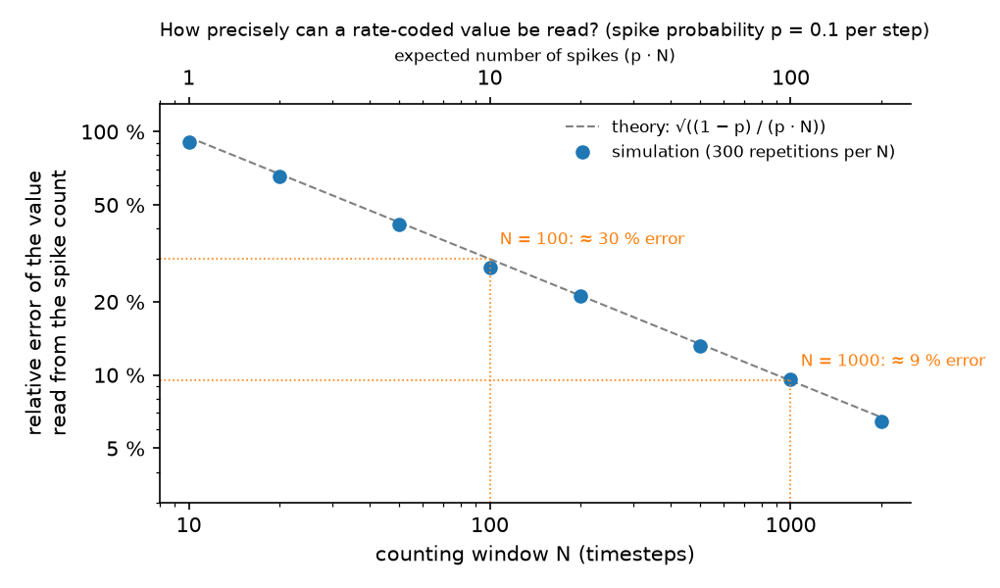

***Figure 18.** How precisely a value can be read from a rate-coded spike train. A `poisson_process` source fires with probability $p = 0.1$ per step, and the spikes are counted over a window of $N$ steps. Because the spikes are random, the count fluctuates from run to run. The plot shows the size of these fluctuations relative to the mean, i.e. the typical error of the value read from the count (dots: 300 simulated runs per window, dashed: theory). The error falls only with $1/\sqrt{N}$: 100 steps (about 10 spikes) give about 30 %, 1000 steps (about 100 spikes) about 9 %. A 10 times longer window, and 10 times more spikes, reduces the error only by a factor of about 3. The top axis shows the expected number of spikes: the error is roughly $1/\sqrt{\text{number of spikes}}$. **Source:** Simulated here in `make_figures.py` (300 runs per window) and compared with the binomial formula.*

</details>

<br>

**Worked example: an MNIST digit.** An image of the [MNIST](https://en.wikipedia.org/wiki/MNIST_database) dataset has 28 × 28 = 784 pixels with values from 0 to 255. Each pixel becomes one input neuron, numbered row by row (neuron index = 28 · row + column). With latency coding computed on the host, the image turns into a `spike_list` population in a few lines:

```python
import numpy as np
from spinnaker2 import snn

img = ...                      # one MNIST image, shape (28, 28), values 0-255
x = img.flatten().astype(int)  # 784 values, neuron i = pixel i; uint8 arithmetic would overflow
t_max = 50

# one spike per non-zero pixel, brighter = earlier; black pixels (0) don't spike
spike_times = {i: [int(t_max * (255 - v) / 255)] for i, v in enumerate(x) if v > 0}

stim = snn.Population(size=784, neuron_model="spike_list", params=spike_times)
```

The cast to `int` matters: MNIST loaders return `uint8` arrays, and with NumPy 2 the product `t_max * (255 - v)` then overflows silently, so every spike time comes out as 0.

The built-in encoder computes the same spike times on the chip, rounded down in the same way: `snn.Population(size=784, neuron_model="spikes_from_array_latency_code", params={"data": x.astype(np.uint16), "x_max": 255, "t_max": 50})`, with `data` as `np.uint16` and `x_max`, `t_max` as Python integers. One difference: it doesn't skip black pixels, but gives them the spike time `t_max` (snn-core code). In a run longer than `t_max` steps, all 668 background pixels of the digit in Figure 19 then fire together at step 50. Running for at most `t_max` steps, or using `spike_list`, avoids this.

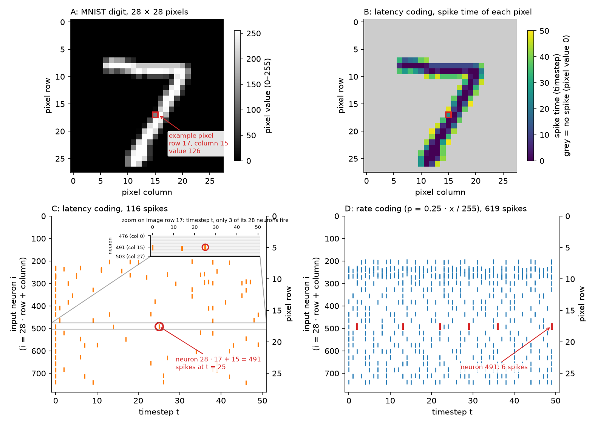

***Figure 19.** An MNIST digit as spike input. A: the image, the first digit of the MNIST test set. B: latency coding assigns each pixel one spike time. The saturated core of the stroke (31 pixels with values of 251–255, about a quarter) spikes at step 0, the softer edges later. Black background pixels don't spike at all, so only 116 of the 784 input neurons are active. C: the same spikes as a raster, one row per input neuron, 116 spikes in total. The neurons are numbered row by row, so every 28 neurons form one image row (right axis), and the active band between neurons 200 and 750 is the part of the image covered by the digit. The 31 simultaneous spikes at step 0 merge into one vertical line. Neuron 0 is at the top, like pixel row 0 in the image, so the raster shows the digit the right way up. Inside the band, most neurons are silent too, but at this resolution neighbouring neurons are less than a screen pixel apart and the spike markers cover the gaps. The inset zooms in on image row 17 (neurons 476–503): only 3 of its 28 neurons fire, the others are black pixels. D: rate coding of the same image over 50 steps: 619 spikes, more than five times as many, and the value of each pixel can only be estimated roughly (Figure 18). Red: one example pixel followed through all panels (row 17, column 15, value 126 → neuron 28 · 17 + 15 = 491, one spike at step 25 with latency coding, 6 spikes with rate coding). In both codes, most input neurons stay silent because most of the image is background. This sparsity is exactly what event-driven hardware profits from. **Source:** Image: MNIST test set (LeCun, Cortes, Burges, CC BY-SA 3.0). Encoding computed here in `make_figures.py`, not yet run on the chip.*

**Decoding the output.** For a classification with one output neuron per class, three readouts are common: the neuron with the most spikes, the neuron that fires first, or the highest membrane potential of output neurons that don't spike at all (`record=["v_last"]`).
<details>
<summary><b>The three readouts in detail:</b> spike count, first spike, membrane potential</summary>

<br>

- **Spike count (rate decoding).** Count the spikes of each output neuron over the whole run, and the neuron with the most spikes wins. Robust and simple, but needs enough timesteps for the counts to differ clearly (Figure 18).
- **First spike (time-to-first-spike).** The neuron that fires first wins, and the network can stop there. Very fast and sparse, since a decision can come after a few steps, but sensitive to noise. It pairs naturally with latency-coded inputs.
- **Membrane potential.** The output neurons get a threshold so high that they never fire. Their $v$ then simply integrates the weighted input over time, like a leaky sum of evidence, and the largest $v$ at the end wins. This avoids the coarse steps of spike counts and is common for SNNs trained with surrogate gradients (section 8): $v$ is a smooth value that a loss function can use directly. In py-spinnaker2, `record=["v_last"]` records only the final value, which saves memory compared with `record=["v"]` for all steps.

</details>

<br>

Besides these one-off runs, py-spinnaker2 can also stream spikes to and from the chip while it runs, e.g. for sensors or closed-loop control ([data streaming](https://spinnaker2.gitlab.io/py-spinnaker2/user_guide/data-streaming.html), tutorial 07).


**Workshop:** 3 min. The rate vs latency trade-off ties directly into the energy story.

## 7. Networks

**Building blocks in py-spinnaker2:** a `Population` is a group of neurons with the same model and parameters. A `Projection` is a list of connections between two populations. A `Network` holds both and runs on the hardware, here a 48-node board (`SpiNNaker2Chip()` would be a single-chip board):

```python
from spinnaker2 import snn, hardware

stim = snn.Population(size=10, neuron_model="spike_list", params={0: [1, 2, 3], 5: [20, 30]})
pop = snn.Population(size=20, neuron_model="lif", params={"alpha_decay": 0.8, "threshold": 1.0}, record=["spikes", "v"])
proj = snn.Projection(pre=stim, post=pop, connections=[[0, 1, 2, 1], [0, 0, -2, 1]])

net = snn.Network("my network")
net.add(stim, pop, proj)
hw = hardware.SpiNNcloud48NodeBoard()
hw.run(net, 50)  # 50 timesteps; the keyword is time_steps, not timesteps
```

The parameters not given (`i_offset`, `v_init`, `v_reset`, `reset`) take their defaults. Some pages of the py-spinnaker2 documentation call `hw.run(net, timesteps=…)`; this fails with `ValueError: time_steps must be provided`, because the parameter is called `time_steps`.

**Architectures:**

- **Feed-forward:** layers like an MLP or CNN. What ML models trained elsewhere look like (section 8).
- **Recurrent:** neurons connect back into their own population. That gives rich dynamics, memory and self-sustained activity.

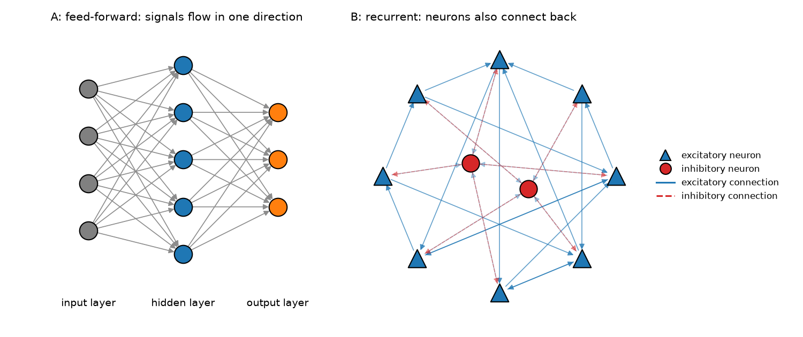

***Figure 20.** A: a feed-forward network. Every neuron sends its spikes only to the next layer, as in an MLP. B: a recurrent network of excitatory neurons (triangles) and inhibitory neurons (circles). Excitatory neurons also excite each other, so activity can circulate and persist without input. The inhibitory neurons receive excitation and feed back inhibition, which keeps this activity in check. **Source:** Diagram.*

**Excitation-inhibition balance:** biological circuits have excitatory and inhibitory neurons (about 80:20). Inhibition keeps activity from exploding. In a *balanced* network, large excitatory and inhibitory inputs roughly cancel, and neurons fire irregularly, driven by fluctuations.

**Clustered networks:** the excitatory neurons are split into groups that are strongly connected internally and weakly connected to each other, with shared inhibition on top. The [clustered SNN example](https://spinnaker2.gitlab.io/py-spinnaker2/examples/clustered_snn.html) of py-spinnaker2 uses 200 excitatory neurons in 10 clusters of 20, and 50 inhibitory neurons:

| Connection | Probability | Weight |
|---|---|---|
| E→E within cluster | 0.5 | 6 |
| E→E between clusters | 0.05 | 2 |
| E→I | 0.3 | 3 |
| I→E | 0.4 | −7 |
| I→I | 0.5 | −3 |

The result is **competition**. A cluster that becomes active excites itself, and through the inhibitory neurons it suppresses the others. With noisy input, activity jumps between clusters: one cluster is "on" for a while, then another takes over (*metastable dynamics*, see Litwin-Kumar & Doiron 2012). These dynamics play out in time, which makes them a natural fit for neuromorphic hardware and a good visual demo (raster plot with switching clusters).

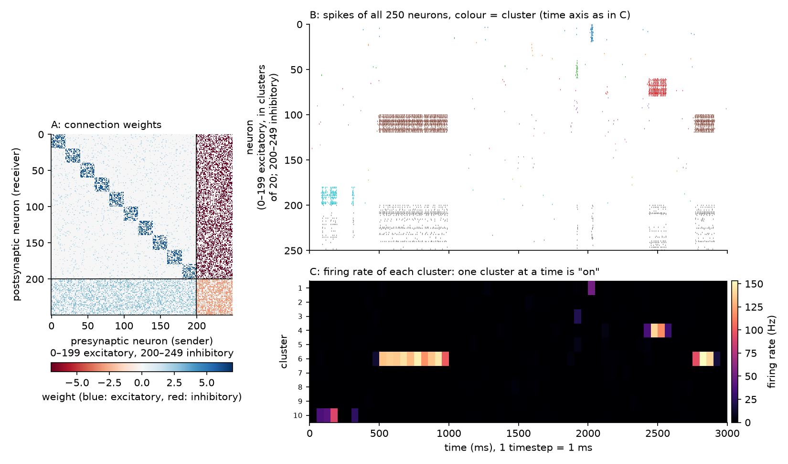

***Figure 21.** A clustered network, simulated with the connection table above and the time constants of the py-spinnaker2 example (`lif_curr_exp`, membrane time constants 15 ms for excitatory and 10 ms for inhibitory neurons, synaptic time constants 3 ms and 5 ms, one timestep = 1 ms). A: the connection matrix. The dark blue squares on the diagonal are the dense, strong connections within the 10 clusters, the light blue dots the sparse, weak connections between clusters, the red columns the inhibition. B: the spikes of all neurons, coloured by cluster (neurons 0–19 form cluster 1, 20–39 cluster 2, and so on, inhibitory neurons in grey). C: the firing rate of each cluster over time. Most of the time, exactly one cluster is active at a high rate while the others are almost silent: cluster 10 at the beginning, then cluster 6 for about half a second, later clusters 4 and 6 again. The inhibitory neurons fire whenever a cluster is active, which suppresses the other clusters. Random input eventually ends each episode, and another cluster takes over. **Source:** Simulated here in `make_figures.py`, not yet run on the chip. Connection table and time constants from the py-spinnaker2 example. Threshold (55), external Poisson input (probability 0.04 per step, weight 6) and refractory period (2 steps) are chosen here, not taken from the example.*

**Workshop:** 5 min on concepts, plus the clustered network as a live demo in the final block.

## 8. SNNs and deep learning

The bridge for an ML audience:

<details>
<summary><b>Terms:</b> ANN, DNN, SNN</summary>

<br>

- **ANN (artificial neural network):** the umbrella term for any network of artificial neurons with weighted connections.
- **DNN (deep neural network):** an ANN with several hidden layers, continuous-valued activations, trained with backpropagation. The basis of modern deep learning: CNNs, Transformers, language models.
- **SNN (spiking neural network):** an ANN whose neurons communicate with discrete, timed spikes instead of continuous values.

DNNs and SNNs are two branches of the same family, distinguished by how neurons communicate. There is no strict threshold for "deep"; in practice it means a few hidden layers or more.

</details>

<br>

- **An LIF neuron is a recurrent cell.** $v[t] = \alpha v[t-1] + W x[t]$ with a binary output $s[t] = \Theta(v[t] - \text{th})$ is a leaky RNN with a step-function activation. A [spiking neural network](https://en.wikipedia.org/wiki/Spiking_neural_network) is an [RNN](https://en.wikipedia.org/wiki/Recurrent_neural_network) with binary, sparse communication.
- **Training problem:** the step function $\Theta$ has zero derivative almost everywhere. **Surrogate gradients** solve this: use $\Theta$ in the forward pass and a smooth function (e.g. a fast sigmoid) in the backward pass, then train with [backpropagation through time](https://en.wikipedia.org/wiki/Backpropagation_through_time). Libraries: snnTorch, Norse, SpikingJelly and others, all on top of PyTorch.
- **ANN-to-SNN conversion:** the firing rate of an IF neuron with reset by subtraction approximates ReLU. So a trained ANN can be converted by replacing ReLUs with spiking neurons, at the cost of many timesteps (details in section 2.5, "Why the ReLU shape matters").
- **Deployment:** the trained model is exported to **NIR** and imported with py-spinnaker2's `s2_nir`. Weights are quantised to the chip's integer ranges (section 4), and quantisation-aware training helps (see the DVS gesture paper in `sources.md`).

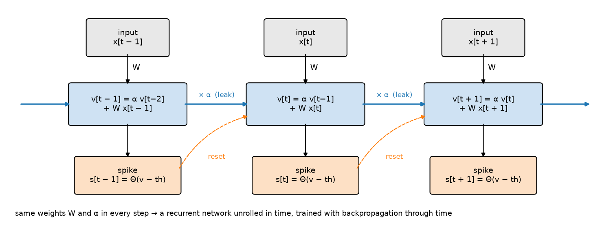

***Figure 22.** An LIF layer unrolled over three timesteps, drawn like an RNN. In every step, the membrane potential $v$ combines its own decayed previous value (blue, factor $\alpha$) with the weighted input $W x$, and the spike output $s$ is a step function of $v$. After a spike, the reset feeds back into the next step (orange). $W$ and $\alpha$ are the same in every step, so training works as for an RNN, with backpropagation through time. The difference to a standard RNN is the output: a sparse binary spike instead of a continuous activation. **Source:** Diagram.*

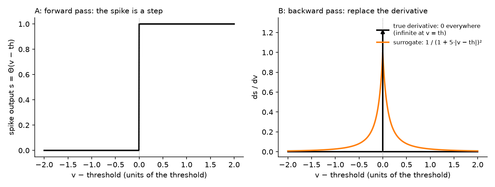

***Figure 23.** Why SNNs need a trick to be trained with gradient descent. A: in the forward pass, the spike output is a step function of the membrane potential. B: its true derivative is zero everywhere except exactly at the threshold, so backpropagation would receive no gradient and nothing would learn. Surrogate-gradient training keeps the step in the forward pass but uses a smooth stand-in for the derivative in the backward pass (orange, here the "fast sigmoid" used e.g. by snnTorch). Neurons whose $v$ is close to the threshold then receive a gradient, and the weights can be adjusted. **Source:** Plot of the functions. The surrogate is the fast sigmoid of snnTorch.*

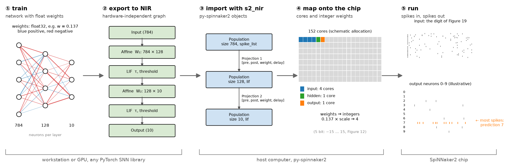

***Figure 24.** The deployment path used in hands-on 2, followed for one MNIST network with 784 input, 128 hidden and 10 output neurons. ① The network is trained in a PyTorch-based SNN library with surrogate gradients (Figure 23). Its weights are floating-point numbers. ② It is exported to NIR, a hardware-independent graph of layers (Affine = weight matrix) and neuron models with their parameters. ③ py-spinnaker2 imports the graph with `s2_nir` and turns it into its own objects: one population per layer, one projection per weight matrix. ④ When the network is run, py-spinnaker2 distributes the neurons across the 152 cores of the chip and converts the weights to the chip's integer ranges (Figure 12). ⑤ The chip runs the network: input spikes (here the latency-coded digit of Figure 19) go in, output spikes come out, and the output neuron with the most spikes is the prediction. **Source:** Diagram. Stages ④ and ⑤ are schematic: the core allocation is illustrative (the real one depends on the neuron model and py-spinnaker2's mapping), and the output spikes are made up, not from a trained model.*

**Sources for moving a model onto SpiNNaker2**, roughly in reading order:

1. [NIR quick start](https://spinnaker2.gitlab.io/py-spinnaker2/user_guide/qs-nir.html) (py-spinnaker2 user guide): the minimal steps from an NIR file to a network on the chip.
2. [Tutorial 08, NIR workflow](https://spinnaker2.gitlab.io/py-spinnaker2/tutorials/deep_dive/08_nir.html): the same workflow step by step.
3. [Example: end-to-end NIR deployment](https://spinnaker2.gitlab.io/py-spinnaker2/examples/end_to_end_NIR.html): train, export, import and run in one notebook.
4. [Example: NMNIST with a pre-trained NIR model](https://spinnaker2.gitlab.io/py-spinnaker2/examples/nir_demo.html): a ready-made model on event-camera data, the likely starting point for hands-on 2.
5. [API reference of `s2_nir`](https://spinnaker2.gitlab.io/py-spinnaker2/api_reference/s2_nir-api.html): the functions of the import module.
6. [snnTorch export to NIR](https://snntorch.readthedocs.io/en/latest/snntorch.export_nir.html): the export step on the training side. The [NIR documentation](https://neuroir.org/docs/) lists the other supported libraries (Norse, Sinabs, Lava-dl, Spyx, …).
7. Background: the [NIR paper](https://www.nature.com/articles/s41467-024-52259-9) (Nature Communications 2024), and two papers that deploy models on SpiNNaker2 this way, with quantisation: [DVS gesture recognition via NIR](https://arxiv.org/abs/2504.06748) and [hardware-aware fine-tuning of spiking Q-networks](https://arxiv.org/abs/2507.23562).

**Workshop:** 5 min. This is where the ML audience engages most, and it leads into hands-on 2 (NIR model on the chip).

## 9. Why this can save energy

- **Event-driven computing:** work happens only when a spike arrives. A silent neuron costs (almost) nothing. A GPU computes every multiply-accumulate (MAC), whether the activation is zero or not.
- **Cheaper operations:** a spike arriving at a synapse is an addition of a weight (an "accumulate"), not a multiplication.
- **Local memory:** weights sit in SRAM next to each core, so less data moves to and from DRAM, whose accesses cost one to two orders of magnitude more energy than an arithmetic operation (Figure 25).

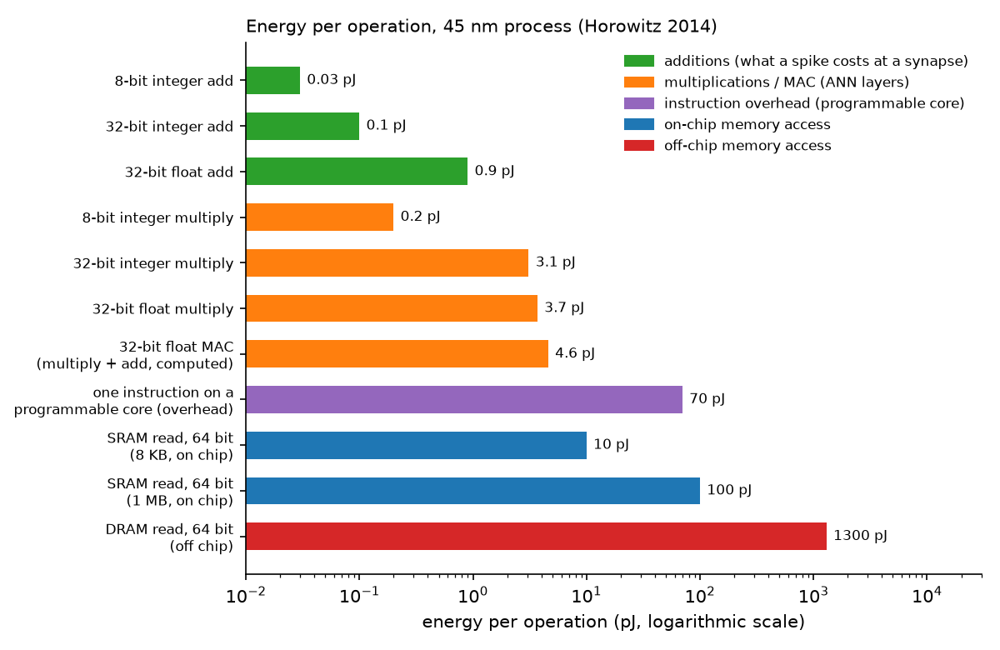

***Figure 25.** Energy of basic operations in a 45 nm chip process, a widely used reference; absolute values are lower in newer processes. Three things matter for neuromorphic hardware. First, an addition, which is what a spike costs at a synapse, is cheaper than a multiply-accumulate (MAC), the basic operation of an ANN layer: 5 times for 32-bit floats, 32 times for 32-bit integers. Second, reading data from off-chip DRAM costs 13 to 130 times more than reading it from on-chip SRAM, depending on the size of the SRAM (the larger the memory, the more each read costs), and more than 1000 times more than a 32-bit addition. Keeping the weights in local SRAM next to each core (as on SpiNNaker2) avoids the most expensive item on the list. Third, on a programmable core every instruction costs about 70 pJ of overhead (fetching and decoding it, accessing registers), far more than the arithmetic it performs. **Source:** Reported data: [Horowitz (ISSCC 2014)](https://doi.org/10.1109/ISSCC.2014.6757323), 45 nm process, 0.9 V. The MAC energy is computed here as multiply + add; the SRAM values are Horowitz's cache reads of 8 KB and 1 MB, the DRAM value the lower end of his 1.3–2.6 nJ.*

The saving depends on **sparsity**. With dense activity or many timesteps (rate coding), the advantage shrinks or disappears. Claims like "18× more efficient than GPUs" depend on the workload, the batch size and what is counted, and an ML audience will ask how they were measured: the "18×" matches one benchmark, a language model run one sample at a time, on which SpiNNaker2 also took 8.6 times longer than the GPU. The workshop should therefore show its own measurement (power measurement in py-spinnaker2) rather than quote marketing numbers. The reported numbers, and how to read them, are in `02_hardware_energy.md`, section 8.

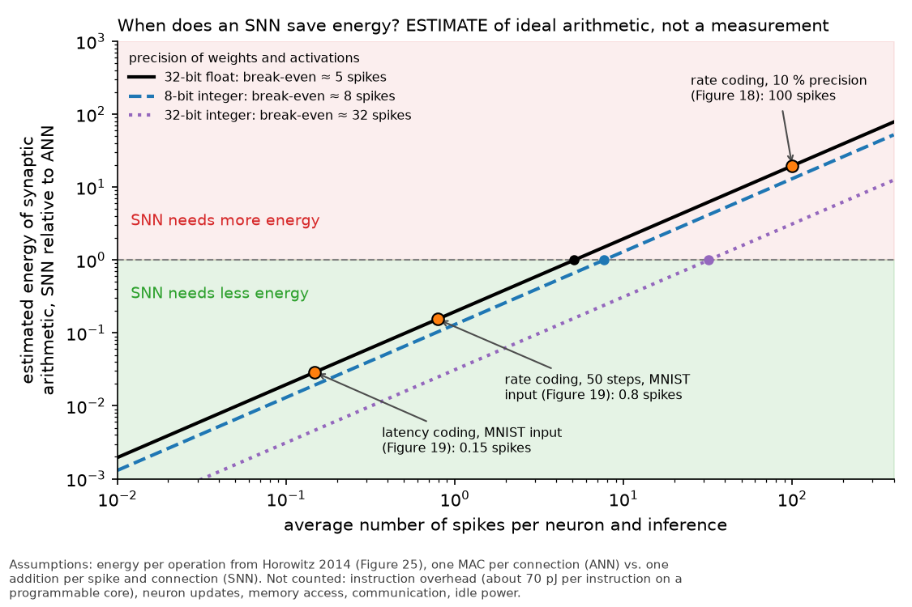

***Figure 26.** An **estimate of ideal arithmetic, not a measurement**, of when sparsity pays off. Only the energy per operation comes from published data (Horowitz 2014, Figure 25). Everything else is computed here from the following assumptions. An ANN layer performs one MAC per connection and inference, whatever the input. An SNN performs one addition per spike and connection, so its cost grows with the number of spikes. With 32-bit floats (MAC 4.6 pJ, addition 0.9 pJ), the estimated energy ratio is (spikes per neuron) × 0.9 / 4.6, so the SNN is cheaper as long as each neuron fires fewer than about 5 spikes per inference. The break-even depends on the precision: about 8 spikes for 8-bit integers, 32 for 32-bit integers. The MNIST examples of section 6 lie well below this (0.15 spikes per input neuron with latency coding, 0.8 with rate coding over 50 steps). Rate coding with 10 % precision (Figure 18) needs about 100 spikes, which gives an estimated factor of about 20 in favour of the ANN at 32-bit float. The model counts only the arithmetic of synaptic operations: it ignores the instruction overhead of programmable cores, neuron updates in every timestep, memory access, communication and idle power. The lines show the trend under these assumptions, not the energy of the chip (see the paragraph below). **Source:** Estimate computed here in `make_figures.py` from the Horowitz values of Figure 25 and the assumptions above, not a measurement.*

**What the estimate leaves out.** On SpiNNaker2 a synaptic event is not a single addition in a dedicated circuit, but a few instructions on the ARM core: take the spike from the input buffer, look up the synapse, read the weight, add it. Each instruction costs far more than the addition itself (Figure 25). Measured on a SpiNNaker2 test chip, one synaptic event costs about 0.2 nJ and one neuron update about 1.5 nJ per timestep, about 200 times the 0.9 pJ assumed in Figure 26, and the baseline power of the chip dominates the total (Höppner et al. 2021, 22FDX prototype). GPUs pay overheads as well, e.g. their idle power when a small batch leaves most of the chip unused (`02_hardware_energy.md`, section 8). The real break-even therefore can't be read off Figure 26 in either direction; it has to be measured.

**Workshop:** the core of the 20 min motivation block, and revisited with real numbers in hands-on 2.

## Glossary

| Term | Meaning |
|---|---|
| Membrane potential $v$ | The neuron's state variable, integrated input |
| Spike | Binary event emitted when $v$ crosses threshold |
| Synapse, weight, delay | Connection, its strength, its transmission time |
| Excitatory / inhibitory | Positive / negative weights, pushing $v$ up / down |
| Population, Projection | py-spinnaker2's group of neurons, set of connections |
| Rate / latency coding | Information in how often / how early neurons spike |
| Surrogate gradient | Smooth stand-in for the spike derivative during training |
| NIR | Neuromorphic Intermediate Representation, like [ONNX](https://en.wikipedia.org/wiki/Open_Neural_Network_Exchange) for SNNs |
| SynOp | Synaptic operation, the unit of work on neuromorphic hardware |

## To check on the cluster

- [ ] Where is the physical duration of a timestep configured, and what is the default?
- [ ] Does the chip use fixed-point or floating-point for $v$ and `alpha_decay` (the ARM M4F has a floating-point unit)?
- [ ] Which of these models does the Brian2 backend support?
- [ ] `lif_prob`: what happens to $v$ when the neuron is above threshold but doesn't fire? And which step size does the chip's `izhikevich` model use?
- [ ] `spikes_from_array_latency_code` and `poisson_process`: exact parameter format (can `p` be an array with one value per neuron?), rounding of spike times, and what happens for input value 0.
- [ ] How does `s2_nir` map NIR neuron types (`LIF`, `CubaLIF`, `IF`) onto py-spinnaker2 models?
- [ ] The docs list `*_no_delay_1024` as "5 bit, [-31, 31]", but 5 signed bits only cover [-16, 15]. Check the actual range.
- [ ] **Validate the figures against the chip.** The chip-model figures are simulated with NumPy reimplementations of the documented update rules (`figures/01_primer_snn_basics/make_figures.py`), not with py-spinnaker2. Run the same inputs on the chip, record `v` and spikes, and compare:
  - [ ] Figure 7 (discrete `lif` update): order of decay, input and threshold check within a step
  - [ ] Figure 9 (reset modes): overshoot handling with `reset_by_subtraction` vs. `reset_to_v_reset`
  - [ ] Figure 10 (delay): arrival at `delay + 1` steps
  - [ ] Figure 11 (`lif` vs. `lif_curr_exp`): synaptic current dynamics and relative amplitude
  - [ ] Figure 12 (quantisation): rounding toward zero and clipping of float weights
  - [ ] Figure 13 (`alif`): threshold adaptation, and which threshold value the reset by subtraction uses
  - [ ] Figure 14 (`izhikevich`): firing patterns with the chip's step size
  - [ ] Figure 15 (`lif_prob`): behaviour of $v$ above threshold when the neuron doesn't fire
  - [ ] Figure 16 (`qubo_neuron`): compare with the QUBO Max-Cut example of py-spinnaker2, which uses the real spike-based coupling
  - [ ] Figure 17 (`poisson_process`, `spikes_from_array_latency_code`): refractory period, mapping of values to spike times and rounding
  - [ ] Figure 19 (MNIST): run the `spike_list` snippet and the built-in encoder on the same image and compare the spike times
  - [ ] Figure 21 (clustered network): run the py-spinnaker2 clustered SNN example and compare its raster with this simulation; also check the connection table and time constants against the example's code
  - [ ] Figure 24 (deployment): replace the schematic stages ④ and ⑤ with the real core allocation and output spikes of a trained MNIST model (hands-on 2)
  - [ ] Figure 26 (energy estimate): compare with the power measurement of py-spinnaker2 for the same network at different spike rates

  Mark each figure as verified in its caption once it matches, or fix the script.
