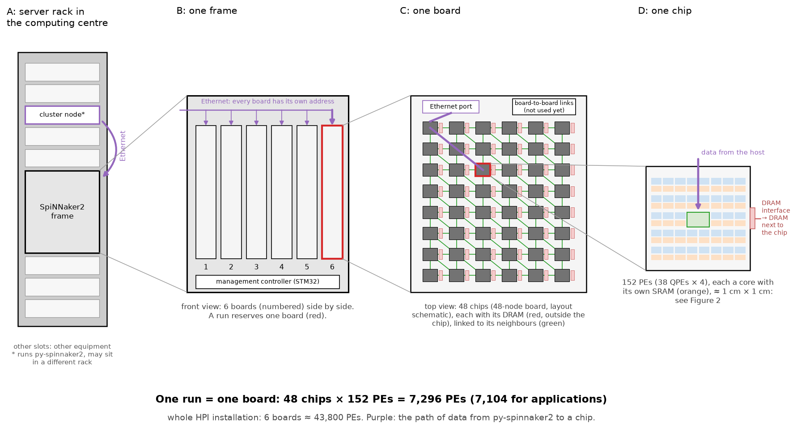
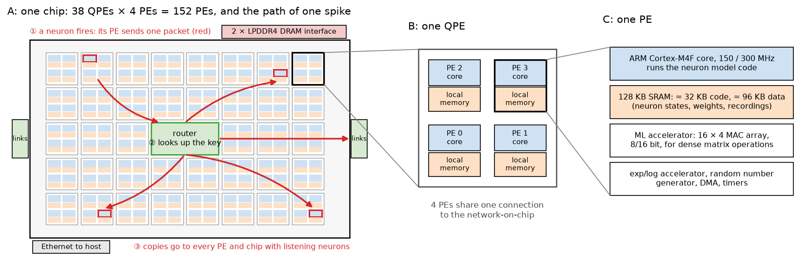
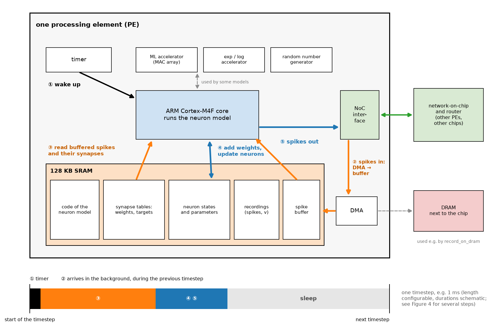
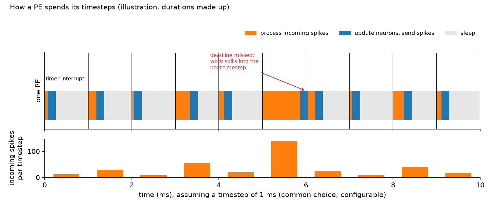
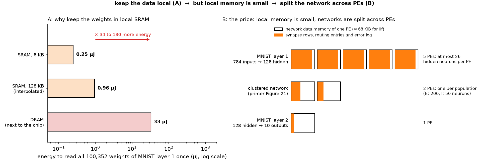
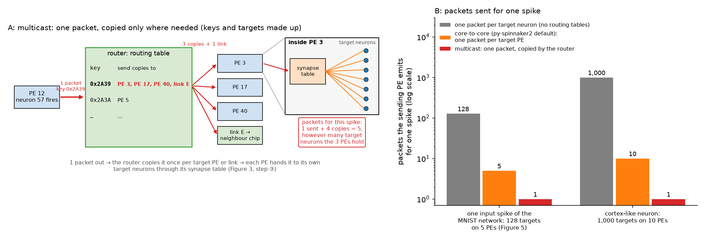
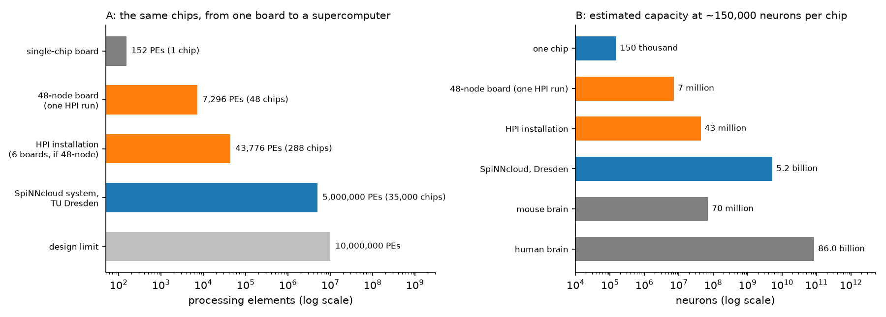
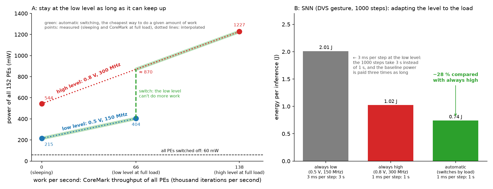
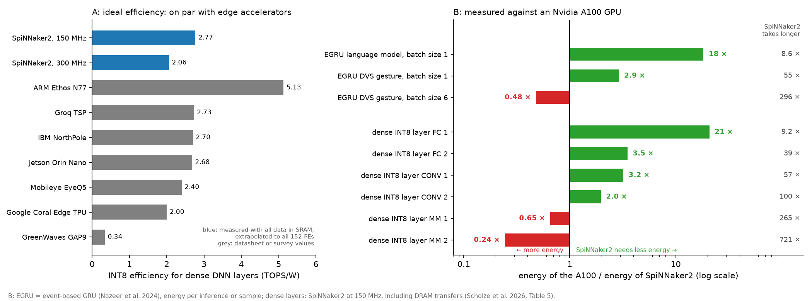

# Hardware and Energy

What the SpiNNaker2 chip consists of, how py-spinnaker2 uses it, which energy numbers are reported, and how energy can be measured on the chip. The groundwork for the "Motivation" block of the workshop (20 min) and for the energy measurement in hands-on 2. Complements the SNN primer (`01_primer_snn_basics.md`), whose section 9 explains *why* event-driven hardware can save energy.

Main sources: the chip paper [Scholze et al. 2026, arXiv:2607.24396](https://arxiv.org/abs/2607.24396), the PE architecture paper [Höppner et al. 2021, arXiv:2103.08392](https://arxiv.org/abs/2103.08392), [Nazeer et al. 2024, arXiv:2312.09084](https://arxiv.org/abs/2312.09084) (the source of the "18×"), and py-spinnaker2 v0.8: its [documentation](https://spinnaker2.gitlab.io/py-spinnaker2/) (tutorial 06, power measurement, profiling, memory structure) and its code, including the chip-side C code ([snn-core](https://gitlab.com/spinnaker2/snn-core)) and the host library SpiNNMan2. All numbers were checked against the full texts and tables on 2026-09-30.

Each section ends with a line **Workshop:** saying what of it is taught in the workshop.

## Contents

- [1. The chip at a glance](#1-the-chip-at-a-glance)
- [2. The processing element](#2-the-processing-element)
- [3. Memory](#3-memory)
- [4. Communication: spikes as packets](#4-communication-spikes-as-packets)
- [5. From one chip to a supercomputer](#5-from-one-chip-to-a-supercomputer)
- [6. Power management](#6-power-management)
- [7. Limits in practice: when a network doesn't fit](#7-limits-in-practice-when-a-network-doesnt-fit)
- [8. Reported energy numbers](#8-reported-energy-numbers)
- [9. Measuring on the chip](#9-measuring-on-the-chip)
- [To check on the cluster](#to-check-on-the-cluster)

## 1. The chip at a glance

SpiNNaker2 is a many-core chip: instead of a few powerful processors it has 152 small, independent ones, each with its own memory, connected by a network that is optimised for sending many small messages (spikes). The name comes from *Spiking Neural Network Architecture*. It was developed at TU Dresden with the University of Manchester, the successor of SpiNNaker1 (Manchester, 2011), and is produced by [SpiNNcloud Systems](https://spinncloud.com).

Physically, the chips sit on boards, and the boards in a frame in a server rack of the computing centre. Figure 1 follows this hierarchy down to a single chip, with the numbers of the HPI installation (section 5):



***Figure 1.** Where the chips physically are, and how data from py-spinnaker2 reaches them (purple). A: the SpiNNaker2 frame is mounted in a server rack of the computing centre. py-spinnaker2 runs on a cluster node, which talks to the frame via Ethernet. B: the frame, seen from the front, holds 6 boards side by side, each with its own Ethernet connection, and a management controller that switches the boards on and boots them. A run reserves one board (red). C: that board, seen from above: 48 chips (probably, as a 48-node board), each with its own DRAM (red), which consists of separate memory chips next to it on the board. The chips are connected to their neighbours by links on the board (green). Each chip has 6 links: on the square grid of the drawing, these are the 4 horizontal and vertical neighbours plus one diagonal direction, which together form the hexagonal grid of the chip paper. Data from the host enters at a chip and travels over these links to the chips that need it. D: one of these chips, about 1 cm × 1 cm, with its 152 processing elements and their local SRAM (orange), shown in detail in Figure 2. The DRAM itself is outside the chip; on the chip sits only its interface (red, at the edge). Colours as in Figure 2: orange for on-chip SRAM, red for off-chip DRAM and its interface. For users, the relevant size is one board, 7,296 PEs per run. **Source:** Diagram. Numbers from the HPI installation (boot log and vendor, see section 5) and the chip paper (die size 102 mm²). The number of chips per board, the arrangement of chips and links on the board, the position of the cluster node and the entry point of Ethernet traffic on the board are not confirmed yet, the layout is schematic.*



***Figure 2.** A SpiNNaker2 chip at three levels of zoom. A: the chip with its 38 quad processing elements (QPEs), each with 4 processing elements (PEs), every PE drawn as its core (blue) on top of its local memory (orange). Shared by all PEs: the router in the middle, the links to neighbouring chips, the DRAM interface and Ethernet. The red arrows show the path of one spike: the PE of the firing neuron sends one packet, the router looks up the packet's key and sends copies to every PE and to every neighbouring chip that has neurons listening to this sender (section 4). B: one QPE, whose 4 PEs share one connection to the network-on-chip. C: what one PE contains. **Source:** Diagram drawn here from the component list in Scholze et al. 2026 and py-spinnaker2 tutorial 06. The arrangement of the blocks and the spike path are schematic, not the physical floorplan.*

| Property | Value |
|---|---|
| Process | GlobalFoundries 22FDX (22 nm FD-SOI) |
| Die size | 102 mm² |
| Processing elements | 152 (38 QPEs × 4), 148 usable for applications in py-spinnaker2 |
| Processor per PE | ARM Cortex-M4F, 150 MHz at 0.5 V or 300 MHz at 0.8 V |
| Memory per PE | 128 KB SRAM |
| On-chip SRAM in total | 158.6 Mbit (about 19.8 MB) |
| External memory | 2 LPDDR4 interfaces, up to 4 GB each (2 GB on the py-spinnaker2 boards, see section 3) |
| Chip-to-chip links | 6 |
| Host connection | 1 Gbit Ethernet |

**Workshop:** 3 min, the figure and the key idea "many small cores with local memory, connected by a spike network".

## 2. The processing element

Each PE is a small computer of its own:

- **ARM Cortex-M4F core.** A microcontroller-class processor with a single-precision floating-point unit, the kind found in embedded devices. It runs the neuron model code: in every timestep it updates the state of all its neurons and processes incoming spikes.
- **128 KB SRAM.** Holds everything the PE needs: about 32 KB for the compiled neuron model code and about 96 KB for data, i.e. neuron states, parameters, synaptic weights and recorded results.
- **Machine learning accelerator (MLA).** A 16 × 4 array of multiply-accumulate units for 8- and 16-bit integers, for dense matrix operations such as convolutions and DNN layers. Up to 4.56 TOPS (tera operations per second) for the whole chip at 300 MHz in matrix-matrix multiplication, and up to 34.3 times faster than the ARM core with its optimised library (CMSIS) for convolutional layers.
- **Numerical accelerator** for exponentials and logarithms, useful for neuron models with exponential terms.
- **Random number generators:** a pseudo-random generator per PE (32 bit per clock cycle), and one true random number generator for the chip. They drive, for example, `poisson_process` and `lif_prob`.
- **DMA engines** (direct memory access), plus an interrupt controller and timers. DMA moves blocks of data, e.g. between SRAM and DRAM, while the core keeps computing.



***Figure 3.** How the parts of a PE work together in one timestep, with the same colours as Figure 4: processing incoming spikes in orange, updating neurons in blue. ① The timer wakes the core. ② Spike packets that arrived from other PEs are read from the network-on-chip interface. ③ For each spike, the core reads from the synapse tables in its SRAM which of its neurons are targets, and with which weights. ④ It adds the weights to these neurons and updates the states of all its neurons, also in SRAM. ⑤ Neurons that crossed their threshold send a spike packet into the network. The strip at the bottom shows where these steps fall within the timestep: after the work, the PE sleeps until the next timer tick. Everything the core needs sits in its own SRAM, so none of the steps has to wait for DRAM. The accelerators and the DMA engine (dashed) are only used by some models or for recording to DRAM. **Source:** Schematic of the principle, not the physical layout. From the sources: the parts of the PE (chip paper, py-spinnaker2 tutorial 06), the SRAM regions (py-spinnaker2 memory structure) and the timer-driven timesteps (py-spinnaker2 profiling). Assumed here, not confirmed for py-spinnaker2: the order of the steps and their timing, taken from how SNN simulators generally work and from SpiNNaker1, and that the PE sleeps after its work. In particular, incoming spikes may be processed as they arrive, spread over the timestep and triggered by interrupts as on SpiNNaker1, rather than in one block at the start as drawn in the strip. Which models use which accelerator is not known.*

The combination is what the paper calls *hybrid*: the same chip can run event-driven SNNs on the ARM cores and dense DNN layers on the MAC arrays.

<details>
<summary><b>Why SpiNNaker2 is more than "many ARM cores":</b> what the specialised hardware adds</summary>

<br>

A chip with only 152 ARM cores could run SNNs in principle, but poorly. The hardware around the cores makes the difference:

- **MAC accelerator:** dense matrix operations run many times faster than on the ARM core (up to 34.3 times for convolutional layers).
- **exp/log accelerator:** exponential terms of neuron and synapse models take a few clock cycles instead of a software routine.
- **Random number generators:** stochastic models get random numbers essentially for free.
- **DMA:** cores don't spend cycles copying memory.
- **Router with hardware multicast:** one neuron reaching thousands of targets costs one packet, not thousands (section 4). Without this, communication would swamp computation.
- **Chip-to-chip links:** the system scales to millions of cores without a shared bus (section 5).
- **Power management:** DVFS and power shut-off tie energy consumption to activity, and body biasing keeps the PEs fast enough at low voltage (section 6).

The ARM cores provide programmability (any neuron model, written in C), the specialised hardware provides speed and efficiency.

</details>

<br>



***Figure 4.** What a PE does over ten timesteps, here of 1 ms each, a common choice (the length of a timestep is configurable). A timer interrupt starts every step. The PE first processes the spikes that arrived (orange), then updates its neurons and sends their spikes (blue), and sleeps for the rest of the step (grey). The more spikes arrive, the longer the orange part. In a sparse network, the PE sleeps most of the time, which is where the energy saving of event-driven hardware comes from (section 6). If too many spikes arrive in one step (step 6), the work doesn't fit into the step and the next step starts late, a violated real-time deadline (section 7). **Source:** Illustration, spike counts and durations made up. From the sources: timer-driven timesteps and the measurement of the work per timestep and of deadline misses, where work that overruns extends into the following timesteps (py-spinnaker2 profiling). Assumed here: that the work per timestep grows with the number of incoming spikes, the split into spike processing and neuron update, and sleeping for the rest of the step. Not measured on the chip.*

**Is a PE a neuron?** No. Each PE simulates many neurons, hundreds to about a thousand, in software. A closer analogy: a PE corresponds to a small local population of neurons, the router and links play the role of the long-range axons, and synapses are not hardware at all but entries in weight tables in the SRAM.

**Workshop:** 1 min. The ARM core and SRAM matter for the hands-on parts; the accelerators only as an outlook.

## 3. Memory

| Level | Where | Size | Used for |
|---|---|---|---|
| PE-local SRAM | inside each PE | 128 KB | neuron states, parameters, synapses, recordings |
| DRAM (LPDDR4) | outside the chip, shared | 2 GB on the py-spinnaker2 boards (two 1 GB banks) | large data, recordings with `record_on_dram=True` |

Keeping weights in the local SRAM of each PE is central to the energy argument: reading from on-chip SRAM costs about 100 times less energy than reading from external DRAM (primer, Figure 25). Each PE on its own is a small conventional computer, but there is no shared memory or bus for all PEs, so the system as a whole avoids the von Neumann bottleneck of conventional computers (`00_computing_fundamentals.md`, section 2). The price is capacity: 96 KB of data per PE is small, and memory, not compute, is usually what limits how many neurons and synapses fit on a PE (section 7).

The chip paper specifies up to 4 GB per LPDDR4 interface, while tutorial 06 lists 2 GB for the boards used with py-spinnaker2. The likely explanation is the difference between what the chip supports and what is installed on a board, but this is not confirmed (see the list at the end).

Figure 5 makes this concrete with two example networks from the primer. The first is the **MNIST network** of primer sections 6 and 8 (Figures 19 and 24), which classifies handwritten digits: 784 input neurons (one per pixel of a 28 × 28 image), 128 hidden neurons and 10 output neurons (one per digit). Its *layer 1* is the set of connections from the inputs to the hidden neurons: with every input connected to every hidden neuron, that is 784 × 128 = 100,352 synapses. Its *layer 2* connects the hidden neurons to the outputs, 128 × 10 = 1,280 synapses. The second is the **clustered network** of primer section 7 (Figure 21), with 250 neurons and about 12,000 synapses.



***Figure 5.** Why SpiNNaker2 keeps the data local, and what that costs. A: reading all weights of the first MNIST layer (primer Figure 24) once takes about 0.5 µJ from the local SRAM, but about 65 µJ from the DRAM next to the chip, 130 times more. Synapses are read whenever a spike arrives, so over many timesteps this difference adds up. B: the price is capacity. Each box is the data memory of one PE (about 92 KB after heap and stack). The first MNIST layer, with about 100,000 synapses, fills 5 PEs at 4 bytes per synapse, and still 2 PEs at 1 byte per synapse (dashed line). The clustered network (about 12,000 synapses) and the second MNIST layer each fit into one PE. Larger networks therefore have to be split across several PEs; how py-spinnaker2 does this is still to be checked (section 7). **Source:** Estimate computed here. Synapse counts from the example networks (for the clustered network, the expected number from its connection probabilities). The memory per synapse is assumed (1 to 4 bytes, 4 bytes in A), as the synapse format of py-spinnaker2 is not confirmed yet. Energy per 64-bit read from Horowitz 2014 (45 nm, 8 KB SRAM and DRAM), as an order of magnitude, not measured on SpiNNaker2. Memory sizes from the py-spinnaker2 documentation (memory structure, tutorial 06). Routing tables and recordings, which also need memory, are ignored.*

<details>
<summary><b>Memory layout of a PE:</b> what lives where in the 128 KB</summary>

<br>

The 128 KB SRAM of a PE is split into two regions ([memory structure](https://spinnaker2.gitlab.io/py-spinnaker2/advanced_topic/memory/memory-structure.html)):

- **ITCM** (instruction memory, about 32 KB): the compiled code of the neuron model.
- **DTCM** (data memory, about 96 KB): everything the host writes before a run, in this order: reserved sections for the program's variables, error logs, a data specification, the memory regions with routing tables, synapse tables and user data, an optional log region, and a 4 KB heap and stack at the end.

The exact number of bits per synapse and the sizes of the synapse and recording regions aren't documented on that page. They are defined in the linker scripts of the neuron models in py-spinnaker2 and can be visualised with the memory visualisation tool of py-spinnaker2.

</details>

<br>

**Workshop:** 2 min. "Local memory saves energy, but limits size" is the key trade-off.

## 4. Communication: spikes as packets

A spike leaves its PE as a small **multicast packet**: it carries a 32-bit routing key that identifies the sending neuron, and no destination address. The **event router** looks up the key in its routing table (16 K entries) and forwards a copy of the packet to every PE, and every neighbouring chip, that has neurons listening to this sender. One spike can thus reach many targets while being sent only once. This is the core idea inherited from SpiNNaker1, and it suits the brain-like pattern of one neuron talking to thousands of others.

- **On the chip:** a network-on-chip (NoC), a small packet-switched network instead of a shared bus, connects the QPEs, the router and the memory interfaces, with a bisection bandwidth of 307 Gbit/s. Each block is attached through a NoC interface that packs outgoing data into packets and delivers incoming ones.
- **Between chips:** 6 serial links per chip, 6 Gbit/s each on a board and 2 Gbit/s between boards, arranged as a hexagonal grid. Inside the chip, data travels on many parallel wires; for the links, SerDes blocks (serialiser/deserialiser) convert it to a fast serial stream and back, because many parallel wires between chips are hard to keep synchronised.
- **To the host:** 1 Gbit Ethernet. py-spinnaker2 uses it to load the network, start the run and read back the results.



***Figure 6.** How one spike reaches many neurons. A: when a neuron fires, its PE sends a single packet with the neuron's key. The router looks up the key in its table and sends one copy to every PE and link that has target neurons for this sender, here 3 PEs and one link to a neighbouring chip. Inside each target PE, the packet is handed to its own target neurons through the synapse table (step ③ in Figure 3), without any further packets. In total, this spike costs 1 packet plus 4 copies, however many target neurons the 3 PEs hold (red box). The neighbouring chip may copy the packet further to its own PEs. B: the same count for two examples. A spike of an MNIST input neuron has 128 targets in the hidden layer. If layer 1 is split across 5 PEs as in Figure 5, multicast needs 1 packet plus 5 copies instead of 128 packets, about 21 times fewer. For a cortex-like neuron with 1,000 targets on 10 PEs, it is about 91 times fewer. Fewer packets mean less traffic in the network-on-chip and less energy per spike. **Source:** Diagram and computed illustration. Keys, table entries and the distribution of target neurons across PEs are made up or assumed; the principle follows the chip paper (multicast packets with 32-bit keys, routing table with 16 K entries).*

In py-spinnaker2, every PE has an address such as `Chip_1_0_QPE_4_5_2`: chip coordinates (1, 0), QPE coordinates (4, 5), PE 2 within the quad.

<details>
<summary><b>Why the router isn't a bottleneck</b>, although every spike passes through it</summary>

<br>

- **Tiny packets:** a spike packet has a 40-bit base payload, so what matters is the packet rate, not the bandwidth. The router runs at 400 MHz with a peak throughput of 1.8 Tbit/s towards the PEs.
- **Multicast in hardware:** the sender emits one packet regardless of how many targets it has.
- **Precomputed routing tables:** a lookup is a table access, fast and predictable.
- **Sparse traffic:** in event-driven networks most neurons are silent, so the router is rarely saturated.
- **One router per chip:** in a multi-chip system, routing capacity grows with the number of chips, so there is no global choke point.

</details>

<br>

**Workshop:** 2 min, as the explanation of why spikes are cheap to send: one packet per spike, copied only where needed.

## 5. From one chip to a supercomputer

| System | Chips | PEs | Notes |
|---|---|---|---|
| Single-chip board | 1 | 152 | `hardware.SpiNNaker2Chip()` in py-spinnaker2 |
| 48-node board | 48 | 7,296 (7,104 for applications) | `hardware.SpiNNcloud48NodeBoard()` |
| SpiNNcloud system at TU Dresden | about 35,000 | about 5 million | eight racks |
| Design limit | | 10 million | hexagonal chip grid |



***Figure 7.** A: the number of processing elements, from one chip to the largest systems. One run on the HPI installation uses one 48-node board, 7,296 PEs. B: how many neurons that corresponds to, at about 150,000 neurons per chip, compared with the brains of a mouse and a human. Even the Dresden system reaches only a few percent of the neurons of a human brain, and far fewer of its synapses. **Source:** PE and chip counts reported (chip paper, py-spinnaker2 tutorial 06, section 5 for the HPI installation, whose board type is not confirmed). Neuron capacities estimated here from the paper's figure of about 150,000 neurons per chip (with a 1 ms timestep), which depends strongly on connectivity. Brain sizes: common estimates of about 70 million (mouse) and 86 billion (human) neurons.*

**The HPI setup** (as of end of September 2026, from the vendor and from the boot log of a run):

- **6 boards in one frame.** The board management controller of the frame reports 6 boards, and the vendor refers to the installation as a 6-board system.
- **Probably 48-node boards**, i.e. up to 6 × 48 = 288 chips in total. The boot log lists 49 devices on the management bus of a board (48 chips plus a controller), but the board type isn't confirmed yet.
- **One board per run, for now.** Multi-board simulations aren't supported yet and are expected in a few months, so the board-to-board cables aren't needed yet. A single 48-node board is far larger than any network planned for the workshop.
- **Boards are locked per user.** When a run starts, the session software (SpiNNMan2, used by py-spinnaker2) reserves a board with a lock file ("The board is locked for you"). If one board can only be used by one user at a time, at most 6 people can run on the chips simultaneously.

<details>
<summary><b>Reading the boot log:</b> what happens when a run starts</summary>

<br>

The start of a run on the cluster shows the boot sequence of a board:

- the machine configuration is read, and the frame's management controller (an STM32 microcontroller) finds the boards on its management bus
- a board is locked for the user
- the board is power-cycled and the chips are switched on: core clock, adaptive body biasing (`turn on ABB`, which may need a second attempt before it reports `locked`), the LPDDR4 DRAM interfaces, clock distribution, the network-on-chip router, and Ethernet
- `qgrid_adpll with default clk 1200.00 MHz` is the frequency of a clock generator (PLL). The clock of the PEs (150 or 300 MHz) is derived from it by dividing it down, so 1200 MHz is not the PE clock.
- a small operating program (SCAMP) is loaded onto the chips, and the kernel status of each chip is checked

</details>

<br>

**Workshop:** 1 min, the scale as a motivation: the same chips scale from a desk to a supercomputer.

## 6. Power management

The chip adapts its power to the load with **dynamic voltage and frequency scaling (DVFS)**: each PE runs at one of four *performance levels*, combinations of two supply voltages and clock frequencies, e.g. 0.5 V with 150 MHz or 0.8 V with 300 MHz. The dynamic power of a digital circuit grows roughly with frequency × voltage², so the low level needs much less power per clock cycle. PEs that have nothing to do can sleep or be switched off entirely (power shut-off). **Adaptive body biasing** of the 22FDX process compensates for manufacturing and temperature variations, so that the PEs reach 150 MHz reliably at only 0.5 V, while keeping leakage low (chip paper; Höppner et al. 2021).



***Figure 8.** Why SpiNNaker2 adapts its performance level to the load. A: the power of the 152 PEs of one chip against the work they do per second, measured as CoreMark throughput, at the two performance levels. Each level combines a supply voltage with a clock frequency. At full load, the low level (150 MHz) does a little less than half the work of the high level (300 MHz), so its line ends in the middle. For the same work, the low level needs much less power: about 404 mW instead of about 870 mW. The cheapest strategy (green) is therefore to stay at the low level as long as it can keep up, and to switch to the high level only when more work is needed. Only the endpoints are measured (all PEs sleeping, all PEs running CoreMark); the dotted lines assume that power grows linearly with the work. Even the sleeping chip draws a considerable baseline, which energy measurements have to subtract (section 9). B: this strategy in practice, for an SNN that classifies DVS gestures (1000 timesteps): automatic switching needs 28 % less energy than running at the high level all the time. Running at the low level all the time needs the most energy, because at 150 MHz the processing doesn't fit into 1 ms, so this run used 3 ms per step and took three times as long. **Source:** Reported (Scholze et al. 2026, Tables 2 and 4): the power of all PEs switched off, sleeping and running CoreMark at 0.5 V / 150 MHz and 0.8 V / 300 MHz, and the CoreMark throughput; the DVS gesture energies per inference and the timestep of each run; the 28 % saving; that the automatic mode switches to the high level above a spike threshold. Computed or assumed here: that sleeping means no work, the linear interpolation between the measured endpoints (including the 870 mW at the low level's maximum work), and the cheapest path (green), which is a conclusion from these assumptions, not a description of how the automatic mode in the paper is implemented.*

In SNNs, the load changes with the spike rate. In the DVS gesture experiment of the paper, each PE switches to the high performance level only when it has received more spikes than a threshold, and otherwise stays at the low level. This saved 28 % energy compared with always running at the high level, while still processing in real time (Figure 8B).

Running at the low level all the time needed the most energy in this experiment, even though it needs the least power for a given amount of work (Figure 8A). The reason is time: at 150 MHz many PEs needed close to 2 ms per step, so the paper used a timestep of 3 ms at the low level. The same 1000 steps then took 3 s instead of 1 s, the run was no longer real time, and the baseline power of the chip had to be paid three times as long (Scholze et al. 2026, p. 10 and Table 4). Slower is therefore not always cheaper: the energy of a run is power × time, and below some voltage the leakage that accumulates over a longer run outweighs what each operation saves (the *minimum energy point*, Höppner et al. 2021).

py-spinnaker2 v0.8 has no setting for the performance level, and its neuron models never switch it (snn-core code), so these results can be reported in the workshop, not reproduced. Which level the chips run at during a py-spinnaker2 run is still to be checked.

**Workshop:** 2 min. Energy saving on this chip is not only "fewer spikes", but also "slow down when there is little to do", as long as the work still fits into each timestep.

## 7. Limits in practice: when a network doesn't fit

A network runs on the chip only if, on every PE, its data fits into the **memory** (about 92 KB after heap and stack, section 3 and Figure 5) and its work fits into one **timestep** (section 2 and Figure 4). If either budget is exceeded, the network has to be spread over more PEs. Claims marked *(assumption, to check)* are not confirmed by the sources read so far and are listed at the end.

**Which budget is tight?** For the workshop networks, memory: the first MNIST layer already needs several PEs (Figure 5). The time budget is generous in comparison. The chip paper reports up to 12 million synaptic events per second per PE (about 12,000 per 1 ms timestep), while an MNIST image with latency coding causes only about 15,000 synaptic events in total, spread over 50 timesteps and several PEs (my estimate). The time budget matters for large, brain-like networks with thousands of synapses per neuron.

**How to notice that a budget is exceeded:**

- **Time:** the profiling reports a deadline miss (`deadline_flag` > 0), and the work extends into the following timesteps (py-spinnaker2, profiling). Whether py-spinnaker2 also warns or stops the run is *(assumption, to check)*.
- **Memory:** presumably py-spinnaker2 fails with an error when it maps the network onto the PEs, before the run starts *(assumption, to check)*.

**What helps:**

- **Fewer neurons per PE:** less data and less work per PE, at the cost of more PEs. Whether and how the number of neurons per PE can be set is *(assumption, to check)* (tutorial 04, advanced topic "hardware allocation").
- **Recording less:** only the final membrane potential (`record=["v_last"]`) instead of every timestep, or recording to DRAM with `record_on_dram=True` (py-spinnaker2, SNNs on SpiNNaker2).

**Orders of magnitude.** The chip paper gives more than 150,000 neurons per chip at a 1 ms timestep, roughly 1000 neurons on each of the 152 PEs (my calculation). The `*_1024` variants of the neuron models are documented for 1024 neurons per PE (py-spinnaker2, neuron models); the default for the other models is *(assumption, to check)*. These numbers depend strongly on connectivity, weight precision, recording and activity, so they are orders of magnitude, not guarantees.

**Workshop:** 2 min in hands-on 1, as a troubleshooting guide when participants make a network larger.

## 8. Reported energy numbers



***Figure 9.** Two ways to compare SpiNNaker2 with other hardware, and why they give different answers. A: efficiency for dense INT8 DNN layers under ideal conditions. SpiNNaker2 at 150 MHz reaches 2.77 TOPS/W, about as much as edge accelerators such as the Jetson Orin Nano (2.68) or the Coral Edge TPU (2.00); the ARM Ethos N77 is almost twice as efficient. The SpiNNaker2 values were measured with all data in the PEs' SRAM and extrapolated to all 152 PEs, the others are datasheet or survey values. B: measured energy per inference against an Nvidia A100 GPU, and how many times longer SpiNNaker2 takes (right column). The ratio ranges from 0.24 to 21: SpiNNaker2 needs less energy for small layers and for an event-based language model at batch size 1 (the "18 ×"), but more for large matrix multiplications and at batch size 6. It is always slower, by 8.6 to 721 times. **Source:** Reported data: Scholze et al. 2026, Table 3 (A) and Table 5 (B, dense INT8 layers, SpiNNaker2 at 150 MHz including DRAM transfers, A100 with torchao), and Nazeer et al. 2024, Tables II and III (B, event-based GRU, energy per inference or per sample). Ratios computed here.*

<details>
<summary><b>Dense vs. sparse workloads:</b> what the two kinds of workloads in Figure 9 mean</summary>

<br>

- **Dense:** every weight takes part in every computation. In a fully connected or convolutional DNN layer, each output is the sum over *all* inputs multiplied by their weights, whether an input is large, small or zero. The hardware has to do all these multiply-accumulates, so there is no work to skip. GPUs and edge accelerators are built for exactly this. Any energy advantage of SpiNNaker2 here has to come from lower power, not from skipped work.
- **Sparse, event-based:** only a small fraction of the units is active at any moment, and work is only done for the active ones. In an SNN, a synapse is only processed when a spike arrives; in the event-based language model of Figure 9 (EGRU, an event-based variant of the GRU recurrent network), a unit only emits an output when its internal state crosses a threshold, like a spiking neuron. If only 10 % of the units are active, about 90 % of the work disappears. For example, only 116 of the 784 input neurons of an MNIST digit spike with latency coding (primer, Figure 19).

"Sparse" here means sparse *activity* (few events per timestep). It is different from sparse *connectivity* (few synapses per neuron), which reduces memory rather than work. The energy advantage of event-driven hardware comes mainly from sparse activity (primer, section 9 and Figure 26).

</details>

<br>

What the numbers say, and what they don't:

- **Dense DNN layers under ideal conditions** (Figure 9A): SpiNNaker2 is in the same range as dedicated edge accelerators (0.34–5.13 TOPS/W in the same table, most around 2–2.7), not ahead of them. These values assume that the data fit into the on-chip SRAM and that all PEs are busy, and the comparison values are datasheet numbers, not measurements.
- **Dense DNN layers, measured** (Figure 9B): including the DRAM transfers, SpiNNaker2 needs less energy than an A100 for small layers (up to 21 times less for a fully connected layer), but more for large matrix multiplications, where the limited DRAM bandwidth dominates (Scholze et al. 2026, Fig. 11). It is always much slower, by 9 to 721 times. The energy ratio comes from power, not from sparsity: SpiNNaker2 draws less than 1 W, the A100 more than 100 W, even when a small layer leaves most of it idle.
- **The "18 ×" claim:** SpiNNcloud advertises "18× higher energy efficiency than GPUs", without a source. The factor matches one benchmark, quoted in the chip paper: an event-based language model (EGRU) that needs 65 mJ per inference on SpiNNaker2 and 1.19 J on an A100, a factor of 18.3 (Nazeer et al. 2024). That the advertised number comes from this benchmark is *(assumption, to check)*. Two caveats from the source itself: the comparison is at batch size 1, and SpiNNaker2 took 170 ms against 19.9 ms on the A100, 8.6 times longer. The language model only fitted on one chip with batch size 1. For the same kind of network on DVS gestures, the same paper shows what batching does: at batch size 1 SpiNNaker2 needs 2.9 times less energy than the A100, at batch size 6 the A100 needs half as much as SpiNNaker2 (0.011 J vs 0.023 J per sample), because a GPU processes a larger batch in about the same time and SpiNNaker2 doesn't. The "18 ×" is a real measurement, but for single-sample inference where latency doesn't matter, not a general property of the chip.
- **SNN on the chip:** the DVS gesture network (5 layers, 7,859 neurons on 57 PEs, plus 64 PEs for the input spikes) reaches 92 % accuracy on 1 s clips (94.0 % in PyTorch on the full gestures) and needs 0.74–2.0 J per second of input, depending on the performance level (Figure 8B). The chip paper gives no GPU comparison for this workload. The DVS gesture paper (Arfa et al. 2025) runs the same network with a different set-up (600 steps of 3.5 ms) and reports 459 mJ per inference; in its comparison table, IBM's TrueNorth chip needs 18.8 mJ for the same task with a different network. Other neuromorphic chips can be much more efficient for a fixed task.
- **Energy per synaptic event:** the chip paper reports energy per inference or per layer, but no pJ per synaptic operation. The PE architecture paper measured it on a 22FDX test chip with 8 PEs: about 0.2 nJ per synaptic event and about 1.5 nJ per neuron update, both processed in software on the ARM core, with the baseline power of the chip dominating the total (Höppner et al. 2021, Tables I and III). That is about 200 times the energy of the 32-bit addition assumed in primer Figure 26, so that estimate can't be transferred to the chip (primer, section 9).

The general lesson is more nuanced than "sparser is better". Energy ratios depend as much on utilisation, batch size and baseline power as on the workload, and SpiNNaker2 trades speed for energy: its strength is low absolute power for small workloads processed one sample at a time, and for event-driven networks in which most PEs sleep most of the time. The chip paper expects sparse, event-based networks to profit most (Scholze et al. 2026, p. 13), but the measured comparisons above don't isolate sparsity. This is why the workshop should show an own measurement rather than a marketing number, and ask two questions of every "× more efficient": at which batch size, and how much slower?

**Workshop:** 5 min, the core of the motivation block, with the "18 ×" as an example of how to read such claims.

## 9. Measuring on the chip

py-spinnaker2 can measure the power of the board while a network runs ([power measurement](https://spinnaker2.gitlab.io/py-spinnaker2/user_guide/power_measurement.html)):

```python
hw.run(net, timesteps, record_power=True)                    # record power samples
hw.run(net, timesteps, record_power=True, live_power=True)   # additionally show them live
```

- **What is measured** depends on the board (SpiNNMan2 power measurement documentation, the host library that py-spinnaker2 uses):
  - **single-chip board:** the power of five supply rails of the chip, read from shunt resistors by the board's microcontroller: `PL05` and `PL08` (the 0.5 V and 0.8 V supplies of the PEs), `PLL`, `IO` and `Q`, plus their sum (`total`).
  - **48-node board:** one value per board, queried from the frame's backbone controller via SNMP. It is the power of the whole board, i.e. 48 chips with their DRAM, not of the chip that runs the network.
- **Sampling:** every 0.1 s on the single-chip board and every 0.2 s on the 48-node board, according to the py-spinnaker2 documentation. The SpiNNMan2 code polls both at 0.1 s, so the interval on the HPI boards is still to be checked.
- **Output:** `power.parquet` (time, channels, total, markers for phases such as the start and end of the simulation) and `power.png`, in `spinnaker2_diagnostics/volatile_diagnostics/`. The console prints energy, duration and average power, e.g. `Power measurement (sim_start -> sim_end): 30.782 J over 0.513 s, average 60.000 W` (example from the documentation).
- **Limitation:** runs shorter than the sampling interval produce one or no sample. Runs should last several sampling intervals, i.e. at least a few seconds, which means thousands of timesteps at a timestep of 1 ms.

**Consequence for the HPI boards.** If the HPI boards are 48-node boards (section 5), a run reports the power of the whole board. A workshop network on a few PEs changes this by milliwatts (Figure 8A: a fully loaded chip draws about 1.2 W in its PEs), while the board's baseline is likely tens of watts (the documentation's example shows 60 W) *(assumption, to check)*. Whether the energy of a small network is visible above the baseline and its noise at all has to be tested before the workshop relies on it.

The **profiling** of py-spinnaker2 complements this with timing ([profiling](https://spinnaker2.gitlab.io/py-spinnaker2/user_guide/profiling.html)): with `profile=True` on a population, each PE records per timestep how long its work took (`duration_us`) and how many timer periods it overran (`deadline_flag` > 0), in `profiling.parquet`. The file is only written when the persistency level of the diagnostic folder is `volatile` or `persistent`.

<details>
<summary><b>A measurement plan for the workshop:</b> how to get a meaningful energy number</summary>

<br>

A single power reading says little, because the board draws power even when nothing happens (Figure 8), and on a 48-node board this baseline belongs to 48 chips. A meaningful comparison needs:

1. **Baseline:** the power of the board while idle or running an empty network, to subtract, and its fluctuation between samples and runs.
2. **Long enough runs:** several seconds per measurement (thousands of timesteps), because of the 0.1–0.2 s sampling interval.
3. **A large enough difference:** a network spread over many PEs with high activity, so that its energy stands out from the baseline. Repeat each measurement several times.
4. **The same network at different activity levels:** e.g. the MNIST network with latency coding and with rate coding, or a network driven by Poisson inputs of different rates. If the energy above the baseline grows with the number of spikes, this shows the event-driven principle directly.
5. **Energy per inference:** (energy above baseline) / (number of inputs processed), so that numbers can be compared with other hardware.

A GPU comparison is optional and needs care: the same model, the same accuracy, the same batch size, and the energy of the GPU measured the same way (e.g. with `nvidia-smi`), including idle power (section 8).

</details>

<br>

**Workshop:** hands-on 2, where participants measure the energy of their own run.

## To check on the cluster

- [ ] **Once the cluster is available:** check how much DRAM each chip of the HPI boards has (2 GB as in tutorial 06, or up to 2 × 4 GB as the chip supports), e.g. from the board information or by allocating DRAM in a test run.
- [ ] Confirm that the 6 boards of the HPI setup are 48-node boards, and whether one board can be shared by several users at the same time (e.g. on different chips). This decides how many participants can run on the chips in parallel.
- [ ] How the Ethernet port of a board is connected to its chips: only to one chip (as on SpiNNaker1 boards), to several, or to all (every SpiNNaker2 chip has its own Ethernet interface). Figure 1C assumes a single entry chip. Ask the admins or the vendor.
- [ ] **First priority:** power measurement on the HPI boards: the idle baseline of a board and its fluctuation, the sampling interval (0.1 or 0.2 s), and the smallest network whose energy is visible above the baseline (section 9). This decides whether hands-on 2 can measure energy at all.
- [ ] Where SpiNNcloud's "18×" comes from: the EGRU benchmark of Nazeer et al. 2024 or another one (ask the vendor), section 8.
- [ ] Default number of neurons per PE for each neuron model, and how py-spinnaker2 splits populations.
- [ ] Which performance level the chips run at during a py-spinnaker2 run (v0.8 has no setting for it, section 6).
- [ ] Whether the accelerators (MLA, exp/log unit, random number generators) belong to each PE or are shared by the 4 PEs of a QPE. The chip paper lists them per PE; an earlier note claimed they are shared per QPE.
- [ ] **Once the cluster is available:** how many bytes py-spinnaker2 uses per synapse (weight, target, delay), e.g. with its memory visualisation tool. Figure 5A assumes 1 to 4 bytes.
- [ ] **Once the cluster is available:** where the length of a timestep is set in py-spinnaker2 and what its default is (the chip paper uses 1 ms), section 7. Also on the primer's list.
- [ ] What happens when a network exceeds the memory budget of a PE (error during mapping?) or the time budget (only `deadline_flag`, or also a warning or abort?), section 7.
- [ ] Whether and how the number of neurons per PE can be set by the user (tutorial 04, advanced topic "hardware allocation"), section 7.
- [ ] How py-spinnaker2 processes an incoming spike in detail: interrupt or polling, whether DMA is involved, how the synapse tables are laid out (Figure 3 shows only the principle).
- [ ] Whether Höppner et al. 2021 (PE architecture paper) contains a layout image or chip photo of a PE, and link it from section 2.