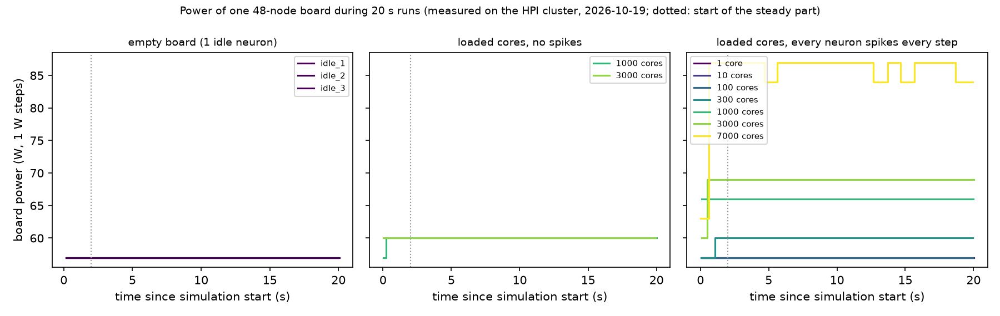
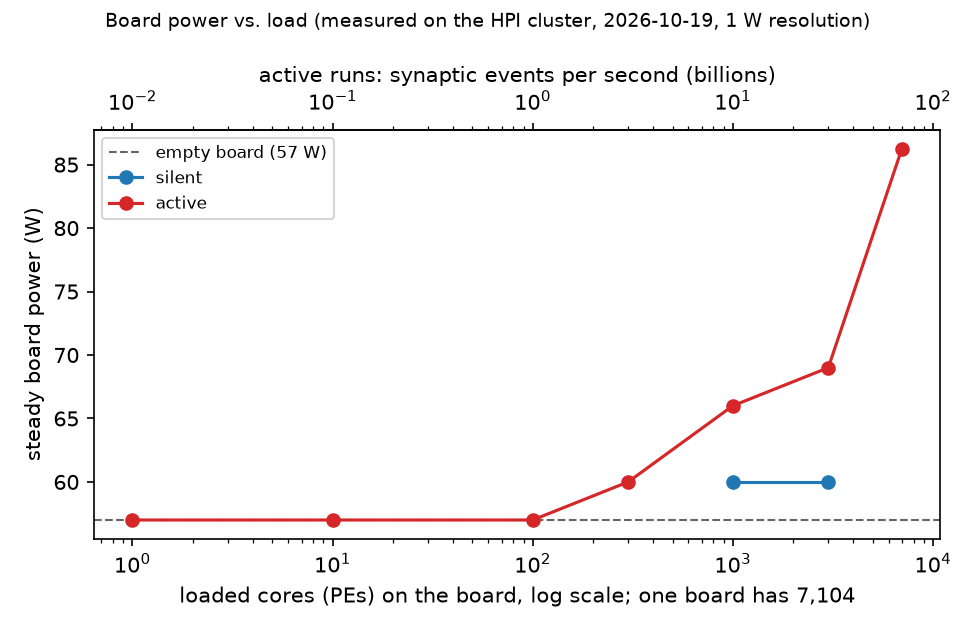

# Power baseline of a 48-node board

Measured on 2026-10-19 on the HPI cluster (cx51, py-spinnaker2 v0.8.2). Question: can the power measurement of py-spinnaker2 show the energy of a network, and how large does the network have to be? This decides whether participants measure their own energy in hands-on 2 (`02_workshop_design/brief.md`).

## Contents

- [The idea in simple words](#the-idea-in-simple-words)
- [How the power is measured](#how-the-power-is-measured)
- [What was run](#what-was-run)
- [Results](#results)
- [What it means for the workshop](#what-it-means-for-the-workshop)
- [Caveats and open points](#caveats-and-open-points)
- [How to reproduce](#how-to-reproduce)
- [Files](#files)

## The idea in simple words

The power value covers the whole board: 48 chips with their memory, and whatever else the board's controller counts. A small network on a few cores is like a feather on a truck scale. The measurement therefore weighs the empty truck first (a network that does nothing), then adds more and more load and looks for the point where the scale moves.

## How the power is measured

- `hw.run(net, T, record_power=True)` records the power during the run and writes `power.parquet` into the diagnostic folder (py-spinnaker2, power measurement).
- On the 48-node board, SpiNNMan2 asks the frame's management controller for the board's power over SNMP. The controller delivers the value already in watts (SpiNNMan2, `power/backend.py`).
- Phase markers in the trace (`load_start`, `sim_start`, `sim_end`, `readout_start`) separate loading, simulation and readout. Loading took only about 0.14 s, too short for a sample, so the empty-network runs serve as the baseline instead of the loading phase.

Found in the pilot run (`00_pilot.py`, `data/pilot.parquet`):

- **Resolution: 1 W.** Every value is a whole number of watts.
- **Sampling: one value every 0.104 s** (192 per 20 s), not 0.2 s as the docs say for the 48-node board.
- **But the value changes at most about once per second.** In the full-board run it switches between 84 and 87 W in steps of about 1 s (Figure 1, right). The controller apparently updates its reading about once per second, and the library reads the same value several times.
- **Lag:** at the start of a run the value reaches its new level 0.3–1 s after `sim_start`. The analysis therefore uses only the part after 2 s ("steady" power).

## What was run

All runs: 20,000 timesteps of 1 ms, i.e. 20 s of simulation, on one 48-node board, nothing recorded from the neurons (so long runs don't fill the core memory). Script: `01_run_power.py`.

| Mode | Network | Load per core |
|---|---|---|
| `idle` | 1 `lif` neuron, no input, never spikes | none |
| `silent` | *n* cores, each one population of 100 `lif` neurons connected all-to-all to themselves (10,000 synapses), no input | the core runs its timer loop, but nothing spikes |
| `active` | the same network, with `i_offset` = 2 above the threshold 1, so every neuron spikes in every step | 100 spikes × 100 targets = 10,000 synaptic events per step, i.e. 10 million per second |

The 10,000 events per core and step equal the load of tutorial 05, which missed no deadline on the HPI chips (`02_hardware_energy.md`, section 7). Each core holds one population, so *n* cores means *n* populations.

Order of the runs (`data/runs.csv`): idle, active with 1, 10, 100, 1000 cores, silent 1000, idle, active 300, 3000, silent 3000, active 7000, idle. The three idle runs at the start, middle and end check for drift.

## Results

| Run | Cores | Steady power (W) | Above empty board (W) |
|---|---|---|---|
| idle (3 runs) | 1 | 57 | 0 |
| active | 1 / 10 / 100 | 57 | 0 |
| active | 300 | 60 | 3 |
| silent | 1,000 | 60 | 3 |
| active | 1,000 | 66 | 9 |
| silent | 3,000 | 60 | 3 |
| active | 3,000 | 69 | 12 |
| active | 7,000 | 86.3 (switching between 84 and 87) | 29 |

Full table with sample counts, minimum and maximum: `data/summary.csv`.



***Figure 1.** Board power during the 20 s simulation window of each run, one panel per mode. The empty board stays at 57 W in all three runs (no drift over the 35 minutes of measurements). Loaded cores without spikes (middle) add 3 W, for 1,000 and for 3,000 cores alike. With spikes (right), 1 to 100 cores stay at 57 W, larger networks rise in whole-watt steps; the full board flips between 84 and 87 W about once per second. Curves of equal value lie on top of each other. The dotted line marks the start of the steady part used for the means. **Source:** measured on one 48-node board of the HPI cluster on 2026-10-19 with `record_power=True`, plotted by `02_analyse.py`.*

<br>



***Figure 2.** Steady board power against the number of loaded cores. The top axis converts the cores of the active runs into synaptic events per second (10 million per core). Below about 1 billion synaptic events per second (100 cores) nothing is visible. Silent cores cost a constant 3 W, independent of their number. **Source:** measured, as Figure 1; steady mean after the first 2 s of each run.*

<br>

**Reading the numbers:**

- **The scale can't see small networks.** Up to 100 fully active cores (1 billion synaptic events per second) the board stays at 57 W.
- **Running cores without spikes cost little:** about 3 W, the same for 1,000 and 3,000 cores. That fits cores that sleep between timer ticks (`02_hardware_energy.md`, section 2).
- **Spiking is what costs energy:** with 1,000 cores, spikes add 6 W on top of the 3 W of the silent network. 6 W for 10 billion synaptic events per second is about 0.6 nJ per event, including the neuron updates and the sending of the spikes. The test chip in Höppner et al. 2021 needs 0.20–0.26 nJ per synaptic event plus 1.5–1.9 nJ per neuron update, so the order of magnitude agrees (estimate here, from a 1 W-resolution reading).
- **The increase is not proportional:** 3,000 active cores add only 3 W more than 1,000, while 7,000 add another 17 W. Possible causes, none checked yet: cores that miss their deadline and do less work per second, placement onto more chips, or the controller's own reading. See the open points.

## What it means for the workshop

- **Participants can't measure their own networks.** A workshop network (an MNIST-sized 784–128–10 network uses about 6 cores, `02_hardware_energy.md`, Figure 5) is far below what the 1 W reading can show. Any such measurement would just read 57 W.
- **A demo can show energy.** A run with 1,000 or more active cores, or the full board, shows a clear difference: silent vs. active at the same size isolates the cost of the spikes (Figure 2). That makes a good instructor demo, or a shared run that participants look at.
- **The core message holds and becomes concrete:** the board costs 57 W just for being on, and only massive spiking activity becomes visible. This is the baseline problem of `02_hardware_energy.md`, section 9, now with measured numbers.

## Caveats and open points

- [ ] **Spike activity not verified.** Nothing was recorded, to keep the runs light. The active runs assume every neuron spikes every step and no deadline is missed. Check with a short run that records `spikes` of a few populations and `time_done`, especially for 3,000 and 7,000 cores (could explain the non-proportional increase).
- [ ] **What the controller measures:** the whole board including DRAM and voltage regulators, and maybe fans. A fan stepping up under heat would show up as power that isn't the chips'. Ask the admins or SpiNNcloud what the SNMP value covers and how often it is updated.
- [ ] **One board only.** All runs used the first free board. Whether all 6 boards have the same 57 W baseline is not checked.
- [ ] **Other users:** a tutorial was run on another board during the 100- and 1,000-core runs (14:13–14:15). Boards are locked per user, and the value is per board, so it should not affect the result; the three identical idle runs support this.
- [ ] **Silent vs. active at 7,000 cores** and repeated runs per size were not measured (each 7,000-core run takes about 9 minutes, mostly for building the configuration on the host).

## How to reproduce

On cx51 in the conda env `spinnaker2` (`03_setup/README.md`), from this folder:

```bash
python 00_pilot.py                            # one 20 s idle run, prints the raw trace
python 01_run_power.py idle_1 1 idle          # name, cores, mode [, time steps]
python 01_run_power.py active_1000 1000 active
python 01_run_power.py silent_1000 1000 silent
uv run --with pandas --with pyarrow --with matplotlib 02_analyse.py
```

Each call of `01_run_power.py` appends one line to `data/runs.csv` and stores the trace as `data/<name>.parquet`. Wall-clock time per run: about 65 s for small networks, 2 minutes for 1,000 cores, 4 minutes for 3,000 and 9 minutes for 7,000 cores.

## Files

| File | Content |
|---|---|
| `00_pilot.py` | First run: what the power data looks like |
| `01_run_power.py` | One measurement: builds the network, runs it with `record_power=True`, stores the trace |
| `02_analyse.py` | Summary table and Figures 1 and 2 |
| `data/*.parquet` | Raw power traces as written by py-spinnaker2 (time, board power, phase markers) |
| `data/runs.csv` | One line per run, written by `01_run_power.py` |
| `data/summary.csv` | `runs.csv` plus steady power, written by `02_analyse.py` |

The diagnostic folders and logs of the runs stay local (`.gitignore`), because they contain internal addresses.
