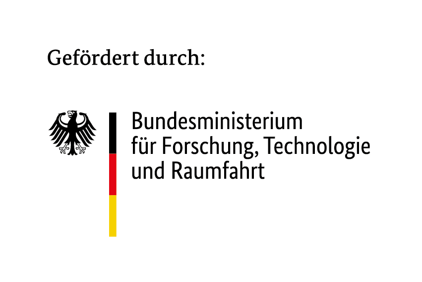

<h1> Workshop: Neuromorphic Computing on SpiNNaker2

Material for a 3-hour hands-on workshop on the SpiNNaker2 neuromorphic chip, aimed at ML researchers and software developers. Participants learn why neuromorphic hardware can save energy, the basics of spiking neurons and networks, and how to run their own spiking networks on SpiNNaker2 chips with [py-spinnaker2](https://spinnaker2.gitlab.io/py-spinnaker2/).

Replace `00_aisc/img/screenshot_app.png` with a screenshot of your application. Keep the image under the description so it is the first thing a visitor sees after the title; a 1280 by 720 PNG renders well on GitHub.

> **Status:** planning. Dates: 18 November 2026, 14:00–17:00, and 9 December 2026, 10:00–13:00.

## Repository structure

| Folder | Content |
|---|---|
| `00_aisc/` | AISC logos and images |
| `01_knowledge_base/` | Notes, sources and figures |
| `02_workshop_design/` | Brief, outline and demo plans |
| `03_setup/` | Running py-spinnaker2 on the HPI cluster, troubleshooting |
| `04_workshop_material/` | The workshop's hands-on notebooks, instructor demos and the install guide for participants |
| `05_measurements/` | Measurements on the chips, e.g. the power baseline of a board, with scripts and data |

## Setup

The workshop runs on the SpiNNaker2 frame attached to the HPI cluster node cx51. Installation, the pinned py-spinnaker2 version and the smoke test are described in [`03_setup/README.md`](03_setup/README.md); failure modes seen so far in [`03_setup/01_troubleshooting.md`](03_setup/01_troubleshooting.md).

py-spinnaker2 itself is **not** tracked here. It is cloned as `py-spinnaker2/` next to the repository content and installed into a conda environment; the directory is gitignored.

## Workshop outline

TODO, see `02_workshop_design/brief.md` for the current draft.

## Author

- [David Goll](https://hpi.de/kisz)

## License

[MIT](LICENSE)

---

## Acknowledgements

The [AI Service Centre Berlin Brandenburg](http://hpi.de/kisz) is funded by the [Federal Ministry of Research, Technology and Space](https://www.bmbf.de/) under the funding code 01IS22092.
