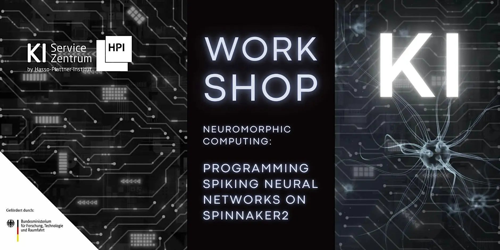

<h1>Workshop: Neuromorphic Computing on SpiNNaker2</h1>

Material of a 3-hour hands-on workshop on the SpiNNaker2 neuromorphic chip, for ML researchers and software developers. You learn why neuromorphic hardware can save energy, the basics of spiking neurons and networks, and how to run your own spiking networks on SpiNNaker2 chips with [py-spinnaker2](https://spinnaker2.gitlab.io/py-spinnaker2/).

## Which setup?

| You have | Guide | During the workshop |
|---|---|---|
| an HPI cluster account | [HPI cluster (conda)](03_setup/01_participants_hpi_cluster.md) | you work on cx51, the cluster node connected to the SpiNNaker2 chips, in VS Code |
| no HPI cluster account | [laptop (uv)](03_setup/02_participants_laptop.md) | you work with the Brian2 simulator, which computes the same spikes as the chips; how to get access to the chips is explained at the end of the workshop |

## What you have to do

Each guide starts with a short table for your situation:

- **You have not installed anything yet:** follow your guide from the start. The download is about 0.5 GB.
- **You installed after our mail of 13 November:** the packages have not changed since then. Run `git pull` in your copy of the repository (on the laptop also `uv sync`, which only checks your environment), then follow the part of your guide on opening the repository in VS Code.
- **HPI cluster:** then set up the VS Code connection to cx51 (in the cluster guide).

Then open `04_workshop_material/00_setup_check.ipynb` and run it. If something fails, ask us.

## What is in this repository

| Folder | Content |
|---|---|
| [`04_workshop_material/`](04_workshop_material/) | The hands-on notebooks: setup check, one neuron, a direction detector built by hand, the same task trained in snnTorch and run via NIR; the instructor demos in `demos/` |
| [`03_setup/`](03_setup/) | Setup guides for the HPI cluster and the laptop, and `enter_cx51.sh` to reserve the SpiNNaker2 node |
| [`01_knowledge_base/`](01_knowledge_base/) | Background notes written for this workshop, with figures and sources (below) |
| [`02_slides/`](02_slides/) | The workshop slides (PowerPoint) |
| [`05_measurements/`](05_measurements/) | Measurements on the chips: the power of a 48-chip board with silent and spiking networks |

The background notes build on each other:

- [Computing Fundamentals](01_knowledge_base/00_computing_fundamentals.md): processors, memory, the von Neumann bottleneck, ARM cores and bare-metal programming
- [Spiking Neurons and Networks](01_knowledge_base/01_primer_snn_basics.md): neuron models, synapses, encoding, network types, training spiking networks and why spikes can save energy
- [Hardware and Energy](01_knowledge_base/02_hardware_energy.md): the SpiNNaker2 chip, its processing elements, memory and communication, power management and what its energy numbers mean
- [Brian2 Fallback](01_knowledge_base/03_brian2_fallback.md): the Brian2 backend of py-spinnaker2 compared with the chip
- [Applications](01_knowledge_base/04_applications.md): published results on SpiNNaker2 and other neuromorphic chips, and where they win
- [History](01_knowledge_base/05_history.md): from SpiNNaker to SpiNNaker2 and Sparxity
- [Sources](01_knowledge_base/sources.md): all papers, documentation and links

## Author

- [David Goll](https://hpi.de/kisz), AI Service Centre Berlin Brandenburg

## License

MIT, see [LICENSE](LICENSE).

## Acknowledgements

The [AI Service Centre Berlin Brandenburg](https://hpi.de/kisz) is funded by the [Federal Ministry of Research, Technology and Space](https://www.bmftr.bund.de/) under the funding code 01IS22092.
